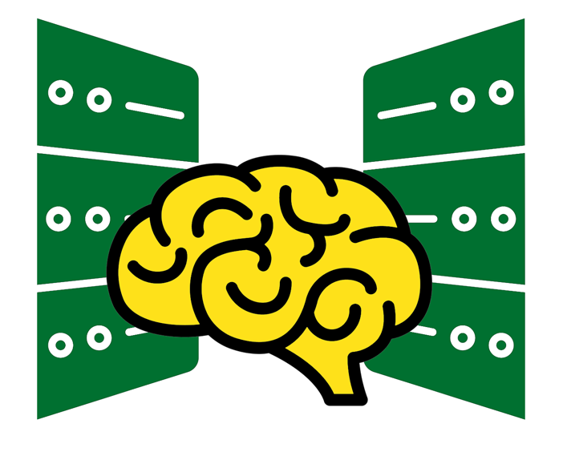

## Introduction to High-Performance Computing
This workshop series prepares attendees to use Talapas, UO's supercomputer. Designed with researchers in mind, this series introduces UNIX commands, bash scripting, environment management, OnDemand, Slurm, parallelization, and other essential Talapas skills.

This webpage archives notes, slides, and code samples from the workshop series. Pardon our mess as we reorganize the site for Fall 2026!

## Fall 2026 Schedule
* [**Introduction to Bash and HPC:**](./bash/main.html) October 13th, 1pm—3pm
* [**Bash Scripting on Talapas:**](./talapas-scripting/main.html) October 15th, 1pm—3pm
* [**Talapas Essentials:**](./talapas-essentials/main.html) October 20th, 1pm—3pm
* [**Running Jobs with Slurm:**](./slurm/main.html) October 22nd, 1pm—3pm
* [**Running Workflows on Talapas:**](./workflows/main.html) October 27th, 1pm—3pm
* [**OnDemand Apps and JupyterLab:**](./ondemand/main.html) October 29th, 1pm—3pm

This page is maintained by [Erin M. Winter](https://library.uoregon.edu/directory/winter) of UO Libraries.