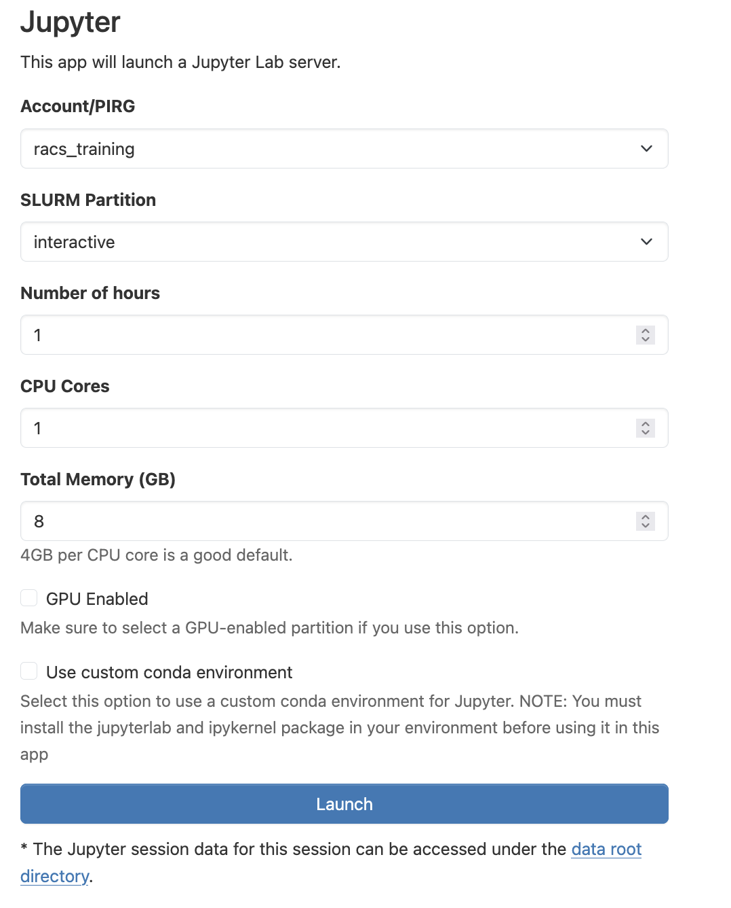
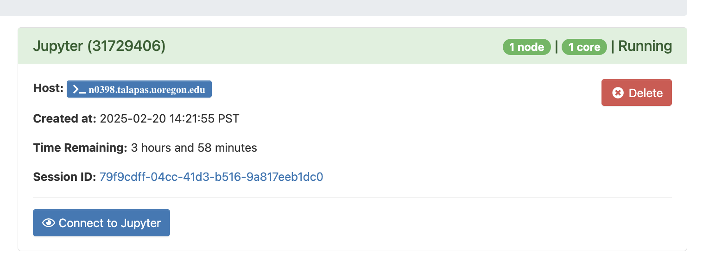
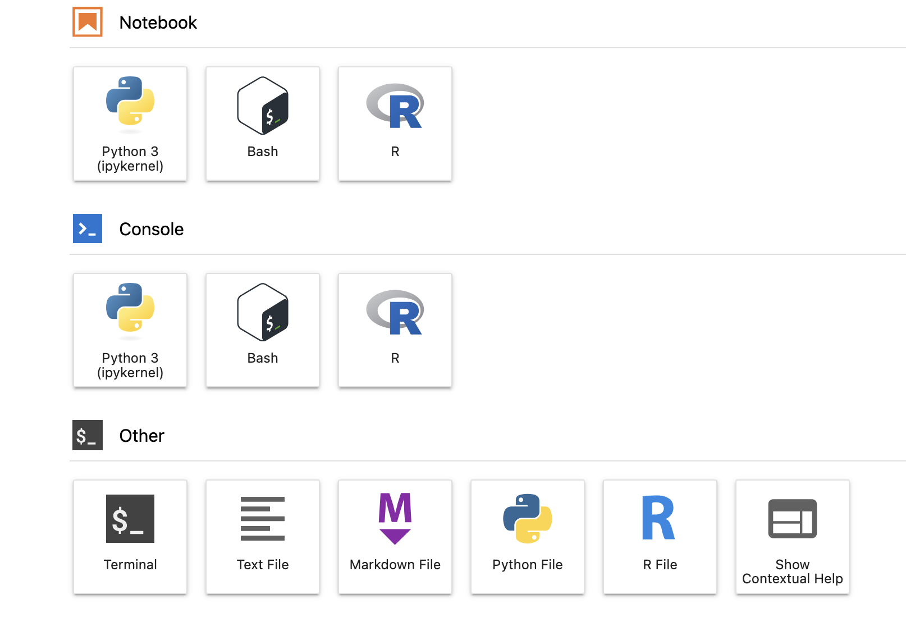
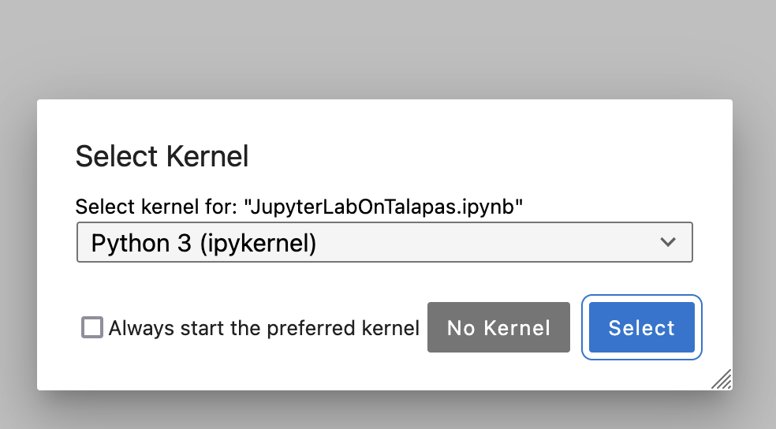

# Configuration

## Getting Today's Notebooks
Connect to a Talapas login node through a terminal application of choice or connect to the [Talapas OnDemand shell](https://ondemand.talapas.uoregon.edu/pun/sys/shell/ssh/login1.talapas.uoregon.edu).


Copy the following folder into your home directory.

```bash
cp -r  .projects/racs_training/intro-hpc-f26/jupyter-f26/ ~
```


## Configuring the OnDemand JupyterLab App

Navigate to the [OnDemand homepage](https://ondemand.talapas.uoregon.edu/pun/sys/dashboard) and login with your **DuckID**.

From the **Interactive Apps** dropdown menu, select **Jupyter**.

*An example JupyterLab configuration screen*

**Account/PIRG**: During the training period, you can use `racs_training`, but you should use *your lab's PIRG* after these trainings finish.

**SLURM Partition:** You have two choices: `interactive` (CPU-based jobs) or `interactivegpu` (if you need GPUs). Only request a GPU if your code or software pipeline can use one.

**Number of hours:** Be considerate and ask only for as much time as you need. You can ask for up to 12 hours on `interactive`, 8 hours on `interactivegpu`. For this exercise, I would select 2 hours.

**CPU Cores:** You must ask for at least `1`. Only code or software packages that are configured to do so can take advantage of multiple cores. 

**Total memory:** We typically recommend 4GB per CPU core. You can ask for up to 100GB.

**GPU enabled:** Only check if you require a GPU. To use a GPU, this box must be checked **AND** you must run on the `interactivegpu` partition.

**Use custom conda environment**: To use Jupyter OnDemand with a custom environment, you need to pass in the *name* of the conda environment.

When you've adjusted your job settings, click the **Launch** button.

## Launching JupyterLab from Sessions
You will automatically be navigated to the **My Interactive Sessions** page. 



When your interactive job has been scheduled, the **Connect to Jupyter** button will display.

If the button does not appear, check the logs in the **Session ID** link. Keep in mind that the more resources you ask for, the longer it will to schedule.

## Selecting a Kernel
JupyterLab supports interaction through Jupyter notebooks in the **Notebook** menu, through an interactive Python interpreter in the **Console** menu, and text editing functionality in the **Other** menu.



A single `conda` environment can have multiple kernels -- for example, we created one that has both an R and Python kernel. 

To run Jupyter Notebooks, you will need to select a [kernel](https://jupyterlab.readthedocs.io/en/stable/user/running.html). You should select the **Python 3 (ipykernel)** from the **Notebook** menu to create, edit, and execute Jupyter Notebooks.

After clicking, you will be prompted to select a specific Python kernel. 


After selecting a kernel, open the `jupyter_examples` folder in your home directory [from within the JupyterLab interface](https://jupyterlab.readthedocs.io/en/stable/user/files.html).

## Exercise Notebooks

Today's lesson continues in the [Notebooks](../jupyterlab/notebooks.html) section.
