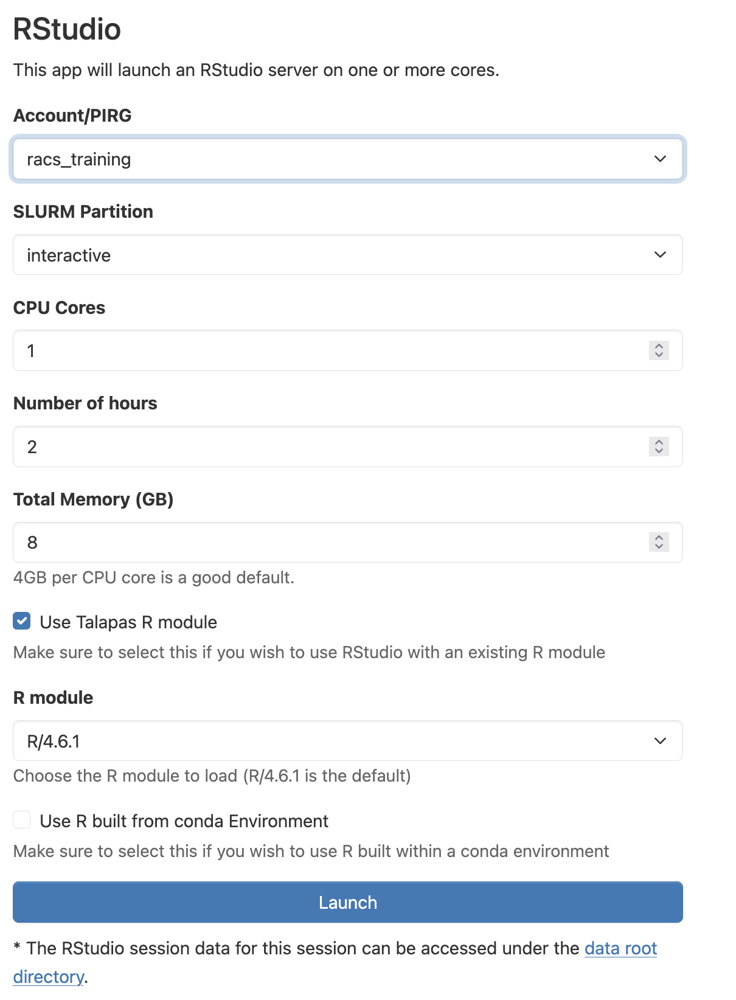
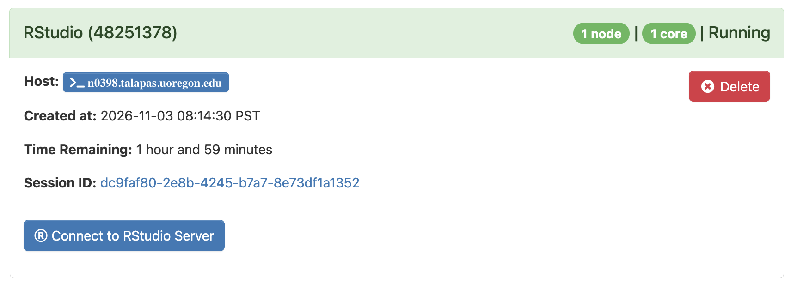
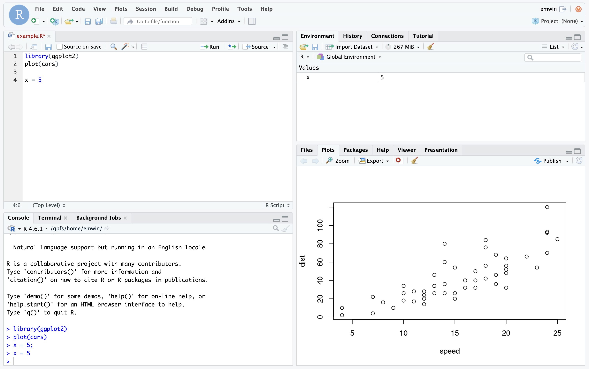

# The OnDemand RStudio App

## Configuring the RStudio App

Navigate to the [OnDemand homepage](https://ondemand.talapas.uoregon.edu/pun/sys/dashboard) and login with your **DuckID**.

From the **Interactive Apps** dropdown menu, select **RStudio**.

You will see the following job configuration screen:

*An example RStudio configuration screen*

**Account/PIRG**: During the training period, you can use `racs_training`, but you should use *your lab's PIRG* after these trainings finish.

**SLURM Partition:** You have two choices: `interactive` (CPU-based jobs) or `interactivegpu` (if you need GPUs). Only request a GPU if your code or software pipeline can use one.

**Number of hours:** Be considerate and ask only for as much time as you need. You can ask for up to 12 hours on `interactive`, 8 hours on `interactivegpu`. For this exercise, I would select 2 hours.

**CPU Cores:** You must ask for at least `1`. Only code or software packages that are configured to do so can take advantage of multiple cores. 

**Total memory:** We typically recommend 4GB per CPU core. You can ask for up to 100GB.

**GPU enabled:** Only check if you require a GPU. To use a GPU, this box must be checked **AND** you must run on the `interactivegpu` partition.

**Use Talapas R module**: Use this to select one of the default Slurm R modules on Talapas from a drop-down menu.

**Use R built from conda environment**: To use R with a custom Conda environment, you need to pass in the name of the Conda environment and the version of miniconda/miniforge it was built with.

### Configuration Tips

* Do not select both the **Use Talapas R Module** and **Use R built from conda environment** options.
* Only Conda environments with [R installed](../workflows/lesson.html#r-in-conda) can be used with the RStudio OnDemand app.
* The more resources you ask for, the longer it will take to schedule.

When you've adjusted your job settings, click the **Launch** button.

## Launching RStudio from Sessions
You will automatically be navigated to the **My Interactive Sessions** page. 

When your interactive job has been scheduled, the **Connect to RStudio Server** button will display.

If the button does not appear, check the logs in the *Session ID* link for debugging purposes. 

## The RStudio Server Interface

The RStudio Server interface will launch. This application resembles the free RStudio Desktop program available for personal computers, but it is connected to the Talapas filesystem and runs as an application on a *compute* node. 

*An example RStudio Server session on Talapas*

### Installing R Packages from CRAN

You can use the `install.packages()` command to install new R packages from [CRAN](https://cran.r-project.org/) to your RStudio Server environment, just as as you would with RStudio Desktop.

These packages are installed to your home directory in the `R/x86_64-pc-linux-gnu-library/` folder by default, so installed packages persist from session to session.

Use the `installed.packages()` in the R console to check which packages you have installed.

## Additional R Resources

### R for Computational Reserachers
- [**R for Data Science**](https://r4ds.hadley.nz/) A free book on data analysis in R using [**Tidyverse**](https://www.tidyverse.org/) from the pioneering Hadley Wickham.
- [**Reproducibility in R and RStudio**](https://unc-libraries-data.github.io/beginR/4-week-model/week_3_reports_EDA/R_OpenLabs_reports_EDA.html) A lesson on reproducibility in R and Rstudio from UNC's BeginR curriculum.

### R Parallel Computing Packages
CRAN has an extensive list of [**parallel computing**](https://cran.r-project.org/web/views/HighPerformanceComputing.html) packages. 
We've tested a few.

- [**R Futures**](https://cran.r-project.org/web/packages/future/vignettes/future-1-overview.html) An R API for asynchronous programming compatible with Slurm.
- [**parallel**](https://r-universe.dev/manuals/parallel.html) This built-in R library works well for single-node jobs, but must be configured carefully to make sure R doesn't use more resources than allocated.
- [**foreach**](https://cran.r-project.org/web/packages/foreach/vignettes/foreach.html) This package can be used in combination with [**doparallel**](https://cran.r-project.org/web/packages/doFuture/vignettes/doFuture-2-dopar.html) or [**doFuture**](https://cran.r-project.org/web/packages/doFuture/vignettes/doFuture-3-dofuture.html) backends to run flexible multi-core R jobs using special for-loop constructs.
