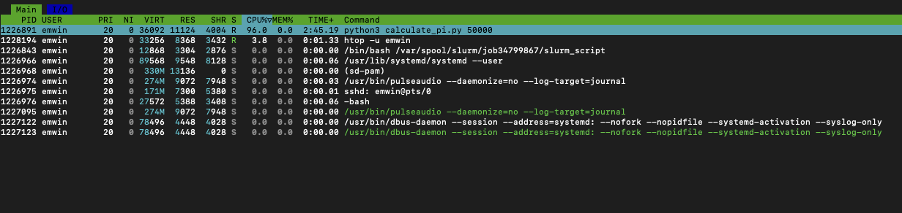

# Debugging Slurm

Let's inspect `hello.sbatch`.

```bash
cat hello.sbatch
```

```bash
#!/bin/bash

#SBATCH --partition=compute              ### Partition (like a queue in PBS)
#SBATCH --account=racs_training          ### Account used for job submission

### NOTE: %u=userID, %x=jobName, %N=nodeID, %j=jobID, %A=arrayMain, %a=arraySub
#SBATCH --job-name=hello_world_python    ### Job Name
#SBATCH --output=%x-%j.out               ### File in which to store job output
#SBATCH --error=%x-%j.err                ### File in which to store job error messages

#SBATCH --time=0-00:05:00                ### Wall clock time limit in Days-HH:MM:SS
#SBATCH --nodes=1                        ### Number of nodes needed for the job
#SBATCH --mem=500M                       ### Total Memory for job in MB -- can do K/M/G/T for KB/MB/GB/TB
#SBATCH --ntasks-per-node=1              ### Number of tasks to be launched per Node
#SBATCH --cpus-per-task=1                ### Number of cpus/cores to be launched per Task

### Load needed modules
module purge
module load python3/3.11.4
module list

### Run your actual program
python3 hello.py
```
Let's parse this file using the comments as a guide! To learn more, see the [Slurm documentation](https://slurm.schedmd.com/sbatch.html) for `sbatch`.

* This job runs for a maximum of five minutes
(`0-00:05:00`) on one node and one CPU core of that node.
* It requests 500MB of RAM.
* The job output will be written `hello_world_python-[jobid].out` and `hello_world_python-[jobid].err` respectively.
* It loads the `python3/3.11.4` module.
* It lists the current modules loaded with `module list` and prints it to standard output.
* It runs a file in the `slurm_examples` directory called `hello.py` that prints to standard output. 

To submit your job file, run the `sbatch` command.

```bash
sbatch hello.sbatch
```

Look at your recent job history with `sacct`.

```bash
sacct
```

```output
JobID           JobName  Partition    Account  AllocCPUS      State ExitCode 
------------ ---------- ---------- ---------- ---------- ---------- -------- 
34658037     hello_wor+    compute racs_trai+          1     FAILED      1:0 
34658037.ba+      batch            racs_trai+          1     FAILED      1:0 
34658037.ex+     extern            racs_trai+          1  COMPLETED      0:0
```

There's an error! Check the error log using `cat`.

```bash
cat hello_world_python-[YOURJOBID].err
```

```output

Currently Loaded Modules:
  1) miniconda-t2/20230523   2) python3/3.11.4

 
Traceback (most recent call last):
  File "/gpfs/home/emwin/part1/hello.py", line 2, in <module>
    print(dictionary['b']) # Should Raise KeyError !!!
          ~~~~~~~~~~^^^^^
KeyError: 'b'
```

This is [KeyError](https://docs.python.org/3/library/exceptions.html#KeyError) a common mistake when using Python dictionaries. 
Check the original Python file in a command line text editor like `nano`.

```bash
nano hello.py
```

Looking at the Python code, there's a bug inside `hello.py`.
```python
print("Hello World !!")

dictionary = {'a': 1}
print(dictionary['b']) # This should raise a KeyError
```
This can be fixed by checking the dictionary for a valid entry: `a`.
Change the last line to the following in `nano`, then use <kbd>Ctrl</kbd>+<kbd>O</kbd> and <kbd>Ctrl</kbd>+<kbd>X</kbd> 
to modify the file.

```python
print(dictionary['a']) # This will not raise a KeyError
```

Now that the file is saved, rerun your fixed job.

```bash
sbatch hello.sbatch
```

```output
Submitted batch job 34704219
```

Running `sacct` will show your job completed successfully.

```bash
sacct
```

```output
JobID           JobName  Partition    Account  AllocCPUS      State ExitCode 
------------ ---------- ---------- ---------- ---------- ---------- -------- 
34704219     hello_wor+    compute racs_trai+          1  COMPLETED      0:0 
34704219.ba+      batch            racs_trai+          1  COMPLETED      0:0 
34704219.ex+     extern            racs_trai+          1  COMPLETED      0:0 
```

Check the output log to see the results of your job. You'll want to pick the *second* and later run's log. Note that because each log is named for the jobid, and jobids are unique, your logs will not overwrite each other.

```bash
1
Hello Wold !!
```

To check the status of your queued jobs, use the `squeue` command. Do not use squeue without an argument unless you want to see *all* the queued jobs on Talapas.

```bash
squeue --me
```

```output
             JOBID PARTITION     NAME     USER ST       TIME  NODES NODELIST(REASON)
```

Notice that because each job creates two log files based on the job id, you will have at least four log files (`%x-%j.err`, `%x-%j.out` ) in your current working directory.

## Cancelling Longer Jobs

Inspect `long.sbatch`.

```bash
cat long.sbatch
```

```output
#!/bin/bash
#SBATCH --partition=computelong          ### Partition (like a queue in PBS)
#SBATCH --account=racs_training          ### Account used for job submission
### NOTE: %u=userID, %x=jobName, %N=nodeID, %j=jobID, %A=arrayMain, %a=arraySub
#SBATCH --job-name=long_hello_world      ### Job Name
#SBATCH --output=%x-%j.out               ### File in which to store job output
#SBATCH --error=%x-%j.err                ### File in which to store job error messages
#SBATCH --time=0-00:20:00                ### Wall clock time limit in Days-HH:MM:SS
#SBATCH --nodes=1                        ### Number of nodes needed for the job
#SBATCH --mem=500M                       ### Total Memory for job in MB -- can do K/M/G/T for KB/M
B/GB/TB
#SBATCH --ntasks-per-node=1              ### Number of tasks to be launched per Node
#SBATCH --cpus-per-task=1                ### Number of cpus/cores to be launched per Task
### Run your actual program
for i in {1..100}
do
    echo "This is loop iteration $i"
    sleep 10
done
```

This job features a Bash for-loop will print one line of text and sleep for ten seconds 100 times, once for each iteration of the loop. 
This means it will run for 1000 seconds or for about 15 minutes.

Inspect the job in the queue.

```bash
squeue --me
```

```output
JOBID PARTITION     NAME     USER ST       TIME  NODES NODELIST(REASON)
34704248 computelo long_hel    emwin  R       0:03      1 n0136
```

Let's practice cancelling a slow job with `scancel`.

```bash
scancel 34704248
```

Looking at the queue again, it's now empty, even though the job would have otherwise run for longer.

```output
JOBID PARTITION     NAME     USER ST       TIME  NODES NODELIST(REASON)
```

When you cancel a job, Slurm will write an error message to the error file for that file.

```bash
cat long_hello_world-34704248.err
```

```output
slurmstepd: error: *** JOB 34704248 ON n0136 CANCELLED AT 2025-05-21T16:42:49 ***
```

## Serial Processing: One Core and One Task at A Time
Navigate inside the `part2` folder using `cd`.

```bash
cd ../part2
```

Check that you see the following files inside with `ls`.

```bash
ls -F
```

```output
array.sbatch*  books/  books.sbatch*  hello.sbatch*  parallel_steps.sbatch*  random.py*  serial_steps.sbatch*  steps.sh*
```


Examine `serial_steps.sbatch` job with `cat.

```bash
cat serial_steps.sbatch
```

```bash
##!/bin/bash

#SBATCH --partition=compute              ### Partition (like a queue in PBS)
#SBATCH --account=racs_training          ### Account used for job submission

### NOTE: %u=userID, %x=jobName, %N=nodeID, %j=jobID, %A=arrayMain, %a=arraySub
#SBATCH --job-name=serial_steps          ### Job Name
#SBATCH --output=%x.out                  ### File in which to store job output
#SBATCH --error=%x.err                   ### File in which to store job error messages

#SBATCH --time=0-00:25:00                ### Wall clock time limit in Days-HH:MM:SS
#SBATCH --ntasks=1                       ### Number of tasks included in the job
#SBATCH --mem-per-cpu=50M                ### Total Memory for job in MB -- can do K/M/G/T for KB/MB/GB/TB
#SBATCH --ntasks-per-node=1              ### Number of tasks to be launched per Node
#SBATCH --cpus-per-task=1                ### Number of cpus/cores to be launched per Task


for i in {1..10}; do
    srun steps.sh $i
done
```

This job runs a Bash for-loop. To learn more about Bash loops, [check out this quick tutorial](../talapas-scripting/loops-variables.html).

This script uses `srun` to create 10 sequential (serial) steps in one job. By default, each iteration (here `i = 1, 2, 3 ... 10`) must finish before the loop moves to the next.

This is because the `srun` denotes a step within a job.
A job with multiple `srun` commands will create a separate step (with the same jobid) in the `sacct`
for each step.

```bash
sbatch serial_steps.sbatch
```

```output
Submitted batch job 34704292
```

Check the queue for the status of your job.
```bash
squeue --me
```

```output
34704292   compute serial_s    emwin  R       0:23      1 n0135
```
As you can observe, the serial job is running and corresponds to exactly one row in the Slurm queue.

However, each step of serial steps (each subjob) is treated as a separaterow in the `sacct` command.,.

```bash
sacct
```

```output
34704292.0     steps.sh            racs_trai+          1  COMPLETED      0:0 
34704292.1     steps.sh            racs_trai+          1  COMPLETED      0:0 
34704292.2     steps.sh            racs_trai+          1  COMPLETED      0:0 
34704292.3     steps.sh            racs_trai+          1  COMPLETED      0:0 
34704292.4     steps.sh            racs_trai+          1  COMPLETED      0:0 
34704292.5     steps.sh            racs_trai+          1  COMPLETED      0:0 
34704292.6     steps.sh            racs_trai+          1  COMPLETED      0:0 
34704292.7     steps.sh            racs_trai+          1  COMPLETED      0:0 
34704292.8     steps.sh            racs_trai+          1    RUNNING      0:0
```

This job is on loop 8 of the serial steps.
34704292.9 can't begin until 34704292.8 finishes.
**Serial jobs require that steps be completed one at a time 
AND in a specific order.**

Let's look at the time spent on each stage in more detail using a specially configured `sacct` command. You can learn more about `sacct` [formatting on the Slurm documentation](https://slurm.schedmd.com/sacct.html).

```bash
sacct -u $(whoami) --units=G --format=JobID,jobname,MaxRSS,Start,Elapsed,State,ExitCode
```

```output
34704292.0     steps.sh          0 2025-05-21T16:45:47   00:00:11  COMPLETED      0:0 
34704292.1     steps.sh          0 2025-05-21T16:45:58   00:00:10  COMPLETED      0:0 
34704292.2     steps.sh          0 2025-05-21T16:46:08   00:00:10  COMPLETED      0:0 
34704292.3     steps.sh          0 2025-05-21T16:46:18   00:00:10  COMPLETED      0:0 
34704292.4     steps.sh          0 2025-05-21T16:46:28   00:00:10  COMPLETED      0:0 
34704292.5     steps.sh          0 2025-05-21T16:46:38   00:00:10  COMPLETED      0:0 
34704292.6     steps.sh          0 2025-05-21T16:46:48   00:00:10  COMPLETED      0:0 
34704292.7     steps.sh          0 2025-05-21T16:46:58   00:00:10  COMPLETED      0:0 
34704292.8     steps.sh          0 2025-05-21T16:47:08   00:00:10  COMPLETED      0:0 
34704292.9     steps.sh          0 2025-05-21T16:47:18   00:00:11  COMPLETED      0:0 
```
As you can see, all ten steps (numbered 0-9) are now marked as `COMPLETED.` Each subjob has a different *start* time.
The subjobs start roughly ten seconds apart, after the previous subjob has finished.

There are some jobs where certain steps or subcomponents must be completed in a serial fashion.
However, serial jobs do not take advantage of the computational power of Talapas or its support for parallelism.
Think of serial computation as a last resort when designing code on Talapas.

How can we make this job run in parallel? Will it be faster?

## Parallelism with `sbatch`

Let's examine `parallel-steps.sbatch` with `cat`.

```bash
cat parallel-steps.sbatch
```

It looks very similar to `serial-steps.sbatch` but there are a few subtle and important differences.

```bash
#!/bin/bash

#SBATCH --partition=compute              ### Partition (like a queue in PBS)
#SBATCH --account=racs_training          ### Account used for job submission

### NOTE: %u=userID, %x=jobName, %N=nodeID, %j=jobID, %A=arrayMain, %a=arraySub
#SBATCH --job-name=parallel_steps        ### Job Name
#SBATCH --output=%x.out                  ### File in which to store job output
#SBATCH --error=%x.err                   ### File in which to store job error messages

#SBATCH --time=0-00:25:00                ### Wall clock time limit in Days-HH:MM:SS
#SBATCH --ntasks=10                      ### Number of tasks included in the job
#SBATCH --cpus-per-task=1                ### Number of cpus/cores to be launched per Task
#SBATCH --mem-per-cpu=50M                ### Number of cpus/cores to be launched per Task

for i in {1..10}; do
    srun --ntasks=1 steps.sh $i &
done
wait
```

This job requests 10 CPUS, allocates 1 CPU per task, and then
launches 10 concurrent `srun` subjobs.

The `&` at the end of `srun --ntasks=1 test.sh $i &` is crucial!
The ampersand tells Bash to *run this command in the background*. Without the ampersand
this loop would wait for one iteration to finish before moving to the next one.

Let's launch this command with `sbatch`.
```bash
sbatch parallel_steps.sbatch
```

```output
Submitted batch job 34704407
```

If you look at the output log, you'll notice something important.

The job steps **don't** complete in order!

```bash
cat parallel_steps.out
```

```output
I am printing this from job step 9
I am printing this from job step 2
I am printing this from job step 1
I am printing this from job step 8
I am printing this from job step 3
I am printing this from job step 7
I am printing this from job step 5
I am printing this from job step 6
I am printing this from job step 10
I am printing this from job step 4
```
The steps in the parallel job **did not run in order** or **finish in order**. You lose that guarantee in a parallel context.

How much faster did the parallel job run?

The serial job ran in 70 seconds.
Use `sacct` to see how much faster the parallel job ran.

```bash
sacct -u $(whoami) --units=G --format=JobID,jobname,MaxRSS,Start,Elapsed,State,ExitCode
```

```output
JobID           JobName     MaxRSS               Start    Elapsed      State ExitCode 
34704407     parallel_+            2025-05-21T16:51:53   00:00:10  COMPLETED      0:0 
34704407.ba+      batch          0 2025-05-21T16:51:53   00:00:10  COMPLETED      0:0 
34704407.ex+     extern          0 2025-05-21T16:51:53   00:00:10  COMPLETED      0:0 
34704407.0     steps.sh          0 2025-05-21T16:51:53   00:00:10  COMPLETED      0:0 
34704407.1     steps.sh      0.00G 2025-05-21T16:51:53   00:00:10  COMPLETED      0:0 
34704407.2     steps.sh          0 2025-05-21T16:51:53   00:00:10  COMPLETED      0:0 
34704407.3     steps.sh          0 2025-05-21T16:51:53   00:00:10  COMPLETED      0:0 
34704407.4     steps.sh          0 2025-05-21T16:51:53   00:00:10  COMPLETED      0:0 
34704407.5     steps.sh          0 2025-05-21T16:51:53   00:00:10  COMPLETED      0:0 
34704407.6     steps.sh      0.00G 2025-05-21T16:51:53   00:00:10  COMPLETED      0:0 
34704407.7     steps.sh      0.00G 2025-05-21T16:51:53   00:00:10  COMPLETED      0:0 
34704407.8     steps.sh          0 2025-05-21T16:51:53   00:00:10  COMPLETED      0:0 
34704407.9     steps.sh          0 2025-05-21T16:51:53   00:00:10  COMPLETED      0:0 
```

The parallel job ran in 11 seconds, significantly faster than the 70 second *serial* version of the job.
This is an example of an *embarassingly parallel* job, because each subjob is completely independent of the other subjobs.


## GPU Jobs
Let's examine an example GPU job in detail: `gpu.sbatch`.

Only three partitions are compatible with GPUs:
* gpu
* gpulong
* interactivegpu

Each node in a GPU partition has **at most** 4 GPUS.

Open `gpu.sbatch` in nano and modify it as follows.

```bash
nano gpu.sbatch
```

```bash
#!/bin/bash

#SBATCH --partition=gpu                  ### Partition (like a queue in PBS)
#SBATCH --account=racs_training          ### Account used for job submission
### NOTE: %u=userID, %x=jobName, %N=nodeID, %j=jobID, %A=arrayMain, %a=arraySub
#SBATCH --job-name=gpu_hello_world       ### Job Name
#SBATCH --output=%x-%j.out               ### File in which to store job output
#SBATCH --error=%x-%j.err                ### File in which to store job error messages
#SBATCH --time=0-00:05:00                ### Wall clock time limit in Days-HH:MM:SS
#SBATCH --nodes=1                        ### Number of nodes needed for the job
#SBATCH --mem=500M                       ### Total Memory for job in MB -- can do K/M/G/T for KB/MB/GB/TB
#SBATCH --gpus=1                         ### Number of GPUs to request 
#SBATCH --ntasks-per-node=1              ### Number of tasks to be launched per Node
#SBATCH --cpus-per-task=1                ### Number of cpus/cores to be launched per Task
#SBATCH --constraint=gpu-10gb
#SBATCH --mail-type=BEGIN,END
#SBATCH --mail-user=YOURDUCKID@uoregon.edu     

### Load needed modules
module purge
module load cuda/12.4.1
module list

### Run your actual program
nvidia-smi
```

* You request at least one gpu with the `--gpus` argument. It's not enough to run on a GPU partition.
* If you need to select certain nodes within a partition, the `--constraint=` flag, can allow you to specify certain nodes based on job constraints. In this case `--constraint=gpu-10gb` restricts the job to nodes with the `gpu-10gb` feature.
* That is, it gives a GPU with 10GB of VRAM.
* Every GPU requires a CPU too!

## Array Jobs

Slurm has a special option for bulk scheduling of nearly identical jobs: [array jobs](https://slurm.schedmd.com/job_array.html).
This approach is less flexible than `srun`, but it can be faster to configure.

Take a close look at `array.sbatch` with `cat`.

```bash
cat array.sbatch
```

```bash
#!/bin/bash

#SBATCH --partition=compute              ### Partition (like a queue in PBS)
#SBATCH --account=racs_training          ### Account used for job submission

### NOTE: %u=userID, %x=jobName, %N=nodeID, %j=jobID, %A=arrayMain, %a=arraySub
#SBATCH --job-name=python_array          ### Job Name
#SBATCH --output=%x-%A-%a.out            ### File in which to store job output
#SBATCH --error=%x-%A-%a.err             ### File in which to store job error messages

#SBATCH --time=0-00:05:00                ### Wall clock time limit in Days-HH:MM:SS
#SBATCH --nodes=1                        ### Number of nodes needed for the job
#SBATCH --mem=50M                        ### Total Memory for job in MB -- can do K/M/G/T for KB/MB/GB/TB
#SBATCH --ntasks-per-node=1              ### Number of tasks to be launched per Node
#SBATCH --cpus-per-task=1                ### Number of cpus/cores to be launched per Task

#SBATCH --array=1-10

### Load needed modules
module purge
module load python3/3.11.4

### Run your actual program
srun python3 random.py $SLURM_ARRAY_TASK_ID $SLURM_ARRAY_JOB_ID $SLURM_JOB_ID
```

Array jobs require the `#SBATCH --array=` parameter.
In this example, the array parameter is the list `{0, 1, 2, ... 10}`.
The `%a` stands for the id of the *task* and the `%A` stands for the main array.

This will create one main job and a subjob for each index in the array. Each array index will inherit the
requested parameters specified in `cpus-per-task` and `ntasks-per-node`. This means each subjob asks for 1 CPU core.

This job runs `random_test.py` and passes in three arguments: the $SLURM_ARRAY_TASK_ID, the $SLURM_ARRAY_JOB_ID and $SLURM_JOB_ID. `$SLURM_ARRAY_TASK_ID $SLURM_ARRAY_JOB_ID $SLURM_JOB_ID` are environment variables.

The advantage of array jobs is that Slurm does not wait for all requested cores to be available
for the first subjobs of the array jobs to be scheduled. *This is not the case for parallel jobs that utilize `srun` to distribute
subjobs among multiple requested cores.*

Let's look in more detail at `random_test.py`.

```bash
cat random_test.py
```

```python
#!/usr/bin/env python3

import random
import sys

if __name__ == "__main__":
    args = sys.argv[1:]
    seed = args[0]
    array_job_id = args[1]
    job_id = args[2]
    print(f"Array Job ID: {array_job_id}  Array Task ID: {seed}  Job ID: {job_id}") 
    print("SEED: {}".format(seed))

    random.seed(seed)
    for i in range(0, 3):
        print(random.random())
```

This Python script takes three arguments (array_job_id, array_task_id, job_id) and and then prints three random numbers
This script will run once for each subjob in the array: 10 times.

Go ahead and submit the array job.

```bash
sbatch array.sbatch
```

```output
Submitted batch job 34704494
```

Array jobs are **parallel** jobs. 

You have no guarantee that all the array jobs will schedule or run at the same time.

Let's check progress the job's progress with `squeue`.

```bash
squeue --me
```

Unlike the paralllel job creatd with `srun`, each array subjob gets its own row in the results of `squeue`.

```output
JOBID PARTITION     NAME     USER ST       TIME  NODES NODELIST(REASON)
34704494_1   compute python_a    emwin  R       0:01      1 n0135
34704494_2   compute python_a    emwin  R       0:01      1 n0135
34704494_3   compute python_a    emwin  R       0:01      1 n0135
34704494_4   compute python_a    emwin  R       0:01      1 n0135
34704494_5   compute python_a    emwin  R       0:01      1 n0135
34704494_6   compute python_a    emwin  R       0:01      1 n0135
34704494_7   compute python_a    emwin  R       0:01      1 n0135
34704494_8   compute python_a    emwin  R       0:01      1 n0135
34704494_9   compute python_a    emwin  R       0:01      1 n0135
34704494_10   compute python_a    emwin  R       0:01      1 n0135
```

Each *subjob* in an array job creates in own log.

```bash
ls python_array*
```

```output
python_array-34704494-10.err  python_array-34704494-2.out  python_array-34704494-5.err  python_array-34704494-7.out
python_array-34704494-10.out  python_array-34704494-3.err  python_array-34704494-5.out  python_array-34704494-8.err
python_array-34704494-1.err   python_array-34704494-3.out  python_array-34704494-6.err  python_array-34704494-8.out
python_array-34704494-1.out   python_array-34704494-4.err  python_array-34704494-6.out  python_array-34704494-9.err
python_array-34704494-2.err   python_array-34704494-4.out  python_array-34704494-7.err  python_array-34704494-9.out
```

To look at the last five lines of each of the output logs logs, you can use the `tail` command.

```bash
tail py*.out
```

```output
...
==> python_array-31638482-8.out <==
Array Job ID: 31638482  Array Task ID: 8  Job ID: 31638490
SEED: 8
0.22991307664292304
0.7963928625032808
0.7965374772142675

==> python_array-31638482-9.out <==
Array Job ID: 31638482  Array Task ID: 9  Job ID: 31638491
SEED: 9
0.1666321090310302
0.02959962356249568
0.629304132385857
```
Notice that each job has its own array task id, its own job id, and a shared array job id.

For convenience, we recommend the [Talapas OnDemand shell](https://ondemand.talapas.uoregon.edu/pun/sys/shell/ssh/login1.talapas.uoregon.edu).

## Parallelism S26

Make sure you are in your home directory.

```bash
cd ~
```

Copy the `slurm_day2` folder to your home directory.
```bash
cp -r /projects/racs_training/intro-hpc-s25/slurm_day2/ .
```

Navigate inside the `slurm_day2` directory you copied over.

```bash
cd slurm_day2
```

## Array Jobs: Creating Tasks from an Array of Input Files
Check the folder contents using `ls`.

```bash
ls -F
```

```output
books_example/  python_pi_example/
deps_example/   snakemake_example/
```

First, we will examine the `books_example` Slurm task.

Change to the `books_example` directory.
```bash
cd books_example
ls -F
```

```output
books/  books.sbatch*  logs/
```


In the `books` folder, you should have the text of five books.

Use `ls` to list the filenames of the books stored there.

```bash
ls books
```

```output
alice_in_wonderland.txt         moby_dick.txt            romeo_and_juliet.txt
complete_works_shakespeare.txt  pride_and_prejudice.txt
```

Let's look at an example array job `books.sbatch` which has one subtask for each of the five books in the `books/` folder.

```bash
cat books.sbatch
```

```bash
#!/bin/bash

#SBATCH --partition=compute              ### Partition (like a queue in PBS)
#SBATCH --account=racs_training          ### Account used for job submission

### NOTE: %u=userID, %x=jobName, %N=nodeID, %j=jobID, %A=arrayMain, %a=arraySub
#SBATCH --job-name=books_wc_array        ### Job Name
#SBATCH --output=logs/%x-%A-%a.out       ### File in which to store job output
#SBATCH --error=logs/%x-%A-%a.err        ### File in which to store job error messages

#SBATCH --time=0-00:05:00                ### Wall clock time limit in Days-HH:MM:SS
#SBATCH --nodes=1                        ### Number of nodes needed for the job
#SBATCH --mem=50M                        ### Total Memory for job in MB -- can do K/M/G/T for KB/MB/GB/TB
#SBATCH --ntasks-per-node=1              ### Number of tasks to be launched per Node
#SBATCH --cpus-per-task=1                ### Number of cpus/cores to be launched per Task

#SBATCH --array=0-4

BOOKS=(books/*)
srun wc -c ${BOOKS[$SLURM_ARRAY_TASK_ID]}
```

First, the variable BOOKS is created using a wildcard `BOOKS=(books/*)`. 

BOOKS is a list of the *filenames* of each of the files in the `books` folder.

```output
books/alice_in_wonderland.txt books/complete_works_shakespeare.txt books/moby_dick.txt books/pride_and_prejudice.txt books/romeo_and_juliet.txt
```

Then, srun is used to launch subtasks that compute the `wc - c` or "word count" in characters of each of the five books.

```bash
sbatch books.sbatch
```

```output
Submitted batch job 34763686
```

Check the status of each of the five tasks using `sacct`.

```bash
sacct
```

```output
34763686_0   books_wc_+    compute racs_trai+          1  COMPLETED      0:0 
34763686_0.+      batch            racs_trai+          1  COMPLETED      0:0 
34763686_0.+     extern            racs_trai+          1  COMPLETED      0:0 
34763686_0.0         wc            racs_trai+          1  COMPLETED      0:0 
34763686_1   books_wc_+    compute racs_trai+          1  COMPLETED      0:0 
34763686_1.+      batch            racs_trai+          1  COMPLETED      0:0 
34763686_1.+     extern            racs_trai+          1  COMPLETED      0:0 
34763686_1.0         wc            racs_trai+          1  COMPLETED      0:0 
34763686_2   books_wc_+    compute racs_trai+          1  COMPLETED      0:0 
34763686_2.+      batch            racs_trai+          1  COMPLETED      0:0 
34763686_2.+     extern            racs_trai+          1  COMPLETED      0:0 
34763686_2.0         wc            racs_trai+          1  COMPLETED      0:0 
34763686_3   books_wc_+    compute racs_trai+          1  COMPLETED      0:0 
34763686_3.+      batch            racs_trai+          1  COMPLETED      0:0 
34763686_3.+     extern            racs_trai+          1  COMPLETED      0:0 
34763686_3.0         wc            racs_trai+          1  COMPLETED      0:0 
34763686_4   books_wc_+    compute racs_trai+          1  COMPLETED      0:0 
34763686_4.+      batch            racs_trai+          1  COMPLETED      0:0 
34763686_4.+     extern            racs_trai+          1  COMPLETED      0:0 
34763686_4.0         wc            racs_trai+          1  COMPLETED      0:0 
```

These following lines of `sbatch` configuration direct the output logs to the `logs` folder.
The `%x-%A-%a` notation creates log files named `(job name)-(array parent job)-(array index)`.out.

```bash
#SBATCH --output=logs/%x-%A-%a.out       ### File in which to store job output
#SBATCH --error=logs/%x-%A-%a.err        ### File in which to store job error messages
```

Inspect the logs folder with `ls`.
```bash
ls logs
```
```output
books_wc_array-34763686-0.err
books_wc_array-34763686-0.out
books_wc_array-34763686-1.err
books_wc_array-34763686-1.out
books_wc_array-34763686-2.err
books_wc_array-34763686-2.out
books_wc_array-34763686-3.err
books_wc_array-34763686-3.out
books_wc_array-34763686-4.err
books_wc_array-34763686-4.out
```
Let's use `tail` and a `*` wildcard to check the last few lines of each of the output logs.

```bash
tail logs/books*.out
```

As expected, the output logs contain the results of the `wc -c` followed by
the book that was listed as input.

```output
==> logs/books_wc_array-34763686-0.out <==
174357 books/alice_in_wonderland.txt

==> logs/books_wc_array-34763686-1.out <==
5638516 books/complete_works_shakespeare.txt

==> logs/books_wc_array-34763686-2.out <==
1276288 books/moby_dick.txt

==> logs/books_wc_array-34763686-3.out <==
772419 books/pride_and_prejudice.txt

==> logs/books_wc_array-34763686-4.out <==
169541 books/romeo_and_juliet.txt
```

## Evaluating Resource Usage on Running Jobs with `htop`
Remember the `seff` command? That's a great way to evaluate resource usage of a *finished* job. But what about resource usage for running jobs?

Navigate to the `python_pi_example` directory and inspect the contents.
```bash
cd ../python_pi_example
ls
```

```output
calculate_pi.py  calculate_pi.sbatch
```

Inspect `calculate_pi.sbatch`.

```bash
nano calculate_pi.sbatch
```

```bash
#!/bin/bash

#SBATCH --partition=compute              ### Partition (like a queue in PBS)
#SBATCH --account=racs_training          ### Account used for job submission

### NOTE: %u=userID, %x=jobName, %N=nodeID, %j=jobID, %A=arrayMain, %a=arraySub
#SBATCH --job-name=digits_of_pi          ### Job Name
#SBATCH --output=%x.log                  ### File in which to store job output

#SBATCH --time=0-00:60:00                ### Wall clock time limit in Days-HH:MM:SS
#SBATCH --nodes=1                        ### Number of nodes needed for the job
#SBATCH --mem=100M                       ### Total Memory for job in MB -- can do K/M/G/T for KB/MB/GB/TB
#SBATCH --cpus-per-task=1                ### Number of cpus/cores to be launched per Task

### Load needed modules
module purge
module load python3/3.11.4
module list

### Run your actual program
python3 calculate_pi.py 50000
```

This is a serial job that loads the **python3** module and executes a Python script that computes the first 5000 digits of pi.

```bash
cat calculate_pi.py
```

```python
#!/usr/bin/env python3

import sys

def calcPi(limit):  # Generator function
    """
    Prints out the digits of PI
    until it reaches the given limit
    """

    q, r, t, k, n, l = 1, 0, 1, 1, 3, 3

    decimal = limit
    counter = 0

    while counter != decimal + 1:
            if 4 * q + r - t < n * t:
                    # yield digit
                    yield n
                    # insert period after first digit
                    if counter == 0:
                            yield '.'
                    # end
                    if decimal == counter:
                            break
                    counter += 1
                    nr = 10 * (r - n * t)
                    n = ((10 * (3 * q + r)) // t) - 10 * n
                    q *= 10
                    r = nr
            else:
                    nr = (2 * q + r) * l
                    nn = (q * (7 * k) + 2 + (r * l)) // (t * l)
                    q *= k
                    t *= l
                    l += 2
                    k += 1
                    n = nn
                    r = nr


def main():  # Wrapper function

    num_digits = sys.argv[1]

    for d in calcPi(int(num_digits)):
        print(d, end='')

if __name__ == '__main__':
    main()
```

Launch the Slurm job with `sbatch`.

```bash
sbatch calculate_pi.sbatch
```

```output
Submitted batch job 34799867
```

Check your queue. Note the node number (hostname) of the compute node where the job is currently running.
```bash
squeue --me
```

```output
             JOBID PARTITION     NAME     USER ST       TIME  NODES NODELIST(REASON)
          34799867   compute digits_o    emwin  R       0:02      1 n0135
```

As we can see, we are currently running on node n0135.

Because we have an active Slurm task on node n0135, we can *remote into that compute node* from the login node with `ssh`.

```bash
ssh n0135
```

Enter the password to your DuckID when prompted. Confirm that you are connected with the `hostname` command.
```bash
hostname
```

```output
n0135.talapas.uoregon.edu
```

While you are on the compute node, the [**htop command**](https://linux.die.net/man/1/htop) can be used to evaluate the resources usage of your running processes. 

```bash
htop -u $USER
```



The `RES` column measures RAM per process in KB.
The `TIME` column indicates how long the process has been running.

Your connection to the compute node will terminate when your job terminates.
After the job has finished, you can use `seff` to get more granular information about your job.