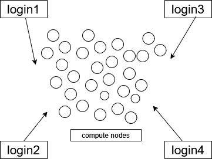
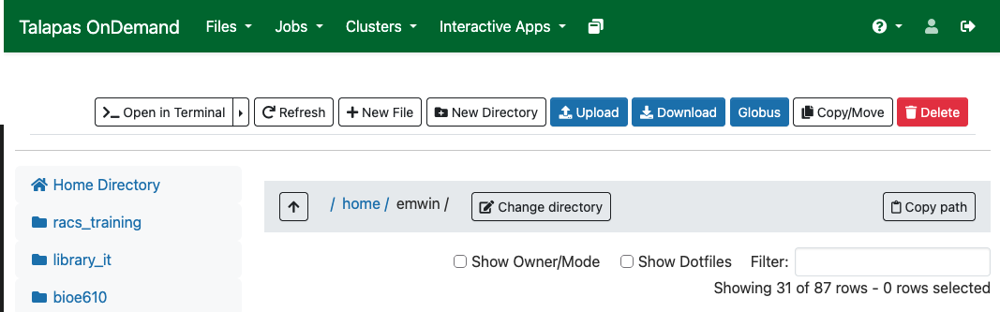
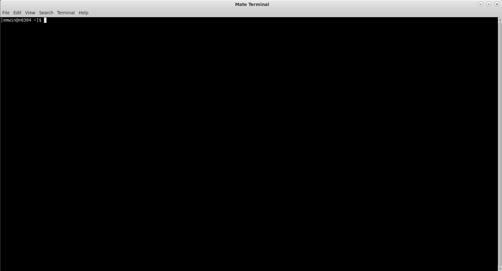
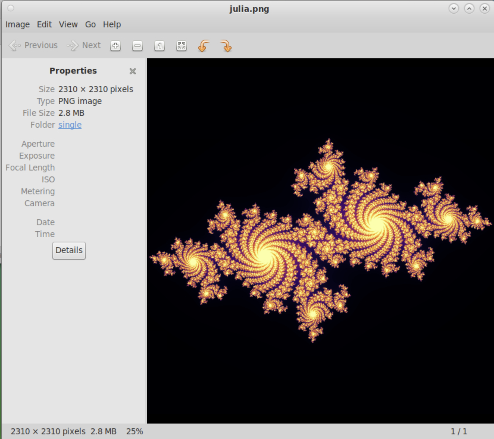
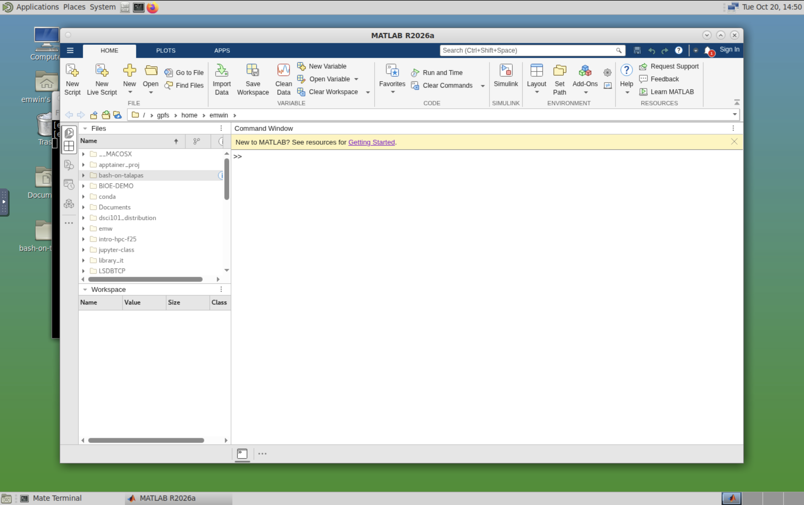

# Talapas Essentials: The Structure of Talapas

## RACS
The Talapas (from Chinook for "coyote") cluster is managed by [Research Advanced Computing Services](https://racs.uoregon.edu/) or RACS. RACS administers the hardware, software, PIRGS, and other key services for Talapas. The best way to reach RACS is through their [customer portal](https://hpcrcf.atlassian.net/servicedesk/customer/portal/1).

## RACS Resources:
* [Talapas Knowledge Base/Documentation](https://uoracs.github.io/talapas2-knowledge-base/)
* [How to Login to Talapas](https://uoracs.github.io/talapas2-knowledge-base/docs/how-to_articles/how-to_login_to_talapas/)
* [Talapas Quick Start Guide](https://uoracs.github.io/talapas2-knowledge-base/docs/quickstart_guide/)
* [Talapas Customer Portal](https://hpcrcf.atlassian.net/servicedesk/customer/portal/1)


## A University Supercomputer

Talapas enables programming tasks that could not be computed without more CPU cores, GPU cores, or memory than are available on consumer hardware.
It also accelerates research at UO by offloading
repetitive, highly parallel computational jobs from researchers' personal or work devices.

Talapas is a heterogeneous cluster consisting of hundreds of individual computers called nodes. 
It is made up of login nodes, compute nodes, and private "condo" nodes. 
These nodes are much more powerful than a personal computer! Each compute node can have up to 128 CPU cores. Some specialized nodes for large memory jobs have up to 4TB of RAM.



Talapas is a living, growing computational ecosystem. New software is added upon request, 
CPU and GPU hardware is periodically upgraded, and new computing nodes are added as research groups buy special nodes for their needs.

### Getting to Talapas: Login Nodes

The four login nodes are shared by hundreds of Talapas users simultaneously. 
The login nodes share the same filesystem, but having multiple login nodes adds redundancy to the Talapas ecosystem.
Login nodes are for loading data, transferring large datasets from the internet or the cloud to the Talapas filesystem, preparing software environments, and connecting to IDEs like VS Code.

The CPU cores and memory on login nodes are **not** for doing computational work. 

[There's a detailed tutorial for connecting to login nodes here](../talapas-scripting/setup.html).

### What is `login.talapas.uoregon.edu`?

Talapas has a load balancer at `login.talapas.uoregon.edu`
that distributes users as evenly as possible among
the four entry or "login" nodes. 

If you connect to `login.talapas.uoregon.edu` through your terminal, you will be routed to one of the four login nodes -- *login1*, *login2*, *login3*, or *login4* -- at random.

If connecting directly to a given login node doesn't work, try another. For example, try `login1` if `login2` times out. If you can't reach *any* of the login nodes, please open a ticket with RACS.

### Compute Nodes
The login and compute nodes share the same filesystem, but
all non-trivial work occurs on *compute nodes*. Work is delegated to compute nodes by the scheduler, Slurm.

The compute nodes on Talapas are grouped into one or more *partitions* based
on what resources they have, how long those resources can be used, and (in the case of private condo nodes) which users can access them.

## The Talapas Filesystem

Talapas uses a 2.6 *petabyte* networked GPFS filesystem to make code, input files, and other crucial pieces of data accessible across all nodes in the cluster.

### Home Directory Storage
All users have 256GB of storage available to them in their home directory at `/home/yourDuckID`. 
No other users have access to your home directory.

You can check your home directory path by using the following Bash command.

```bash
echo $HOME
```
```output
/home/emwin
```

### Projects Directory Storage
If you have access to Talapas, you are also part of a Principal Investigator Research Group or [PIRG](https://uoracs.github.io/talapas2-knowledge-base/docs/about_talapas/pirgs/pirgs/). Each PIRG's shared data lives in `/projects/PIRG_NAME`.

Most PIRG `/projects/` directories have a maximum of 2TB of storage space.

You can see the `/projects/` directory for each PIRG you have access to through the command line or in the [OnDemand Files app](../talapas-scripting/setup.html). 



They are pinned to the left side of the Files app, underneath a link to your home directory. In the example above, I am a member of three PIRGS (`racs_training`, `library_it`, and `bioe610`) so I have access to three shared directories.


### PIRG Storage Structure
Because the [file structure for PIRGs recently changed](https://uoracs.github.io/talapas2-knowledge-base/docs/directory_structure/), some PIRGS may have a slightly different structure in their `/projects/PIRG_NAME` folder.


### New PIRGs
If your PIRG was created within the past two years, all files and folders within a PIRG are shared among all members.
That means any files stored in `/projects/PIRG` are, by default, readable by members of that PIRG. 

For example, all members of `racs_training` can access files and folders in the `/projects/racs_training` directory. 
This is why everyone was added to a single, temporary PIRG
for the purpose of sharing files among all members of the workshop.

### Sharing Files in Legacy PIRGs
Older PIRGS were created with the same storage limit but a *different permissions structure*.
This implementation had problems for collaboration among lab members, as labs have members that leave to work at other institutions. 

Each user had their own folder within their PIRG with files their labmates couldn't see at `/projects/PIRG/DuckID` but all members could access data shared in `/projects/PIRG/shared`. It wasn't uncommon for lab members to want to share files and folders from their `/projects/PIRG/DuckID` folders with fellow lab members.

### I am a PI and have a legacy PIRG. Can you fix my group's permissions now that members have left?
Yes, to fix the file structure and permissions within your `projects/PIRG` directory, [open a ticket with RACS](https://hpcrcf.atlassian.net/servicedesk/customer/portal/1). 

RACS can help retrofit your PIRG into a flatter file structure with simpler permissions. 
When your PIRG is modified, you can choose to keep the existing file and permissions structure or have the new file permissions scheme implemented.

### Which Folder Should I Use for What?
RACS has detailed documentation on [storage best practices](https://uoracs.github.io/talapas2-knowledge-base/docs/storage). For most users, there are three locations you can choose from to store data on Talapas. *None of these options are backed up*.

- **Home Directory** `/home/yourDuckID`: 256GB
    - code, testing instances, personal work

- **Projects Directory** `/projects/yourPIRG`: 2TB
    - datasets, project data, code you want to share with other members of your PIRG

- **Scratch Directory** `/scratch/yourPIRG`: 20TB
    -  temporary files, large intermediate results, files are deleted after 90 days if not read or written to

## Transferring Files to Talapas
There are a variety of ways to transfer files to and from Talapas based on your use case.

- To transfer files to Talapas from your web browser you can use the [Talapas file browser](../talapas-scripting/setup.html#ondemand---files). There's a 10GB limit on what you can upload at a time.
- To transfer files from the command line, use the `scp` command.
- To transfer datasets to Talapas from the internet, use the `wget https://<URL>` command on a **login node**. Remember, compute nodes are firewalled.
- For complex or large-scale transfers, try [Globus](https://uoracs.github.io/talapas2-knowledge-base/docs/data_movement/globus) or FTP tools like [Filezilla](https://filezilla-project.org/).
- For transfer between different institutions, [Globus](https://uoracs.github.io/talapas2-knowledge-base/docs/data_movement/globus) is the preferred tool.

## Software: Modules on Talapas
Software on Talapas is controlled through [lmod](https://lmod.readthedocs.io/en/latest/) modules.

To run software from within a Slurm job, you'll need to load the appropriate modules.

For example, let's load Python. Connect to Talapas using the [OnDemand shell](../talapas-scripting/setup.html#ondemand---clusters---talapas-shell-access){:target="_blank"} or a terminal application of your choice.

Start by loading Python 3.11 from the Python module. Module paths are case-sensitive, but you can use the <kbd>Tab</kbd> key to auto-complete them.

```bash
module load python3/3.11.4
```

To see the modules you currently have loaded, run `module list`.
```bash
module list
```

```output
Currently Loaded Modules:
  1) miniconda-t2/20230523   2) python3/3.11.4
```

Now that the Python module has been loaded through lmod, you can access it using the `python3` command. 

Use `which` to see where the binary is located.

```bash
which python3
```

```output
/packages/miniconda-t2/20230523/envs/python-3.11.4/bin/python3
```

Use the `--version` command to confirm that the `python3` binary has the version number you expect.
```bash
python3 --version
```

```output
Python 3.11.4
```

To remove a module, use the `module unload` command followed by the module name.

```bash
module unload python3/3.11.4 
```

Or get rid of ALL modules with `module purge`.

```bash
module purge
```

Now, you can see that there are no modules loaded. 

```bash
module list
```
```output
No modules loaded
```

### Modules and PATH
The lmod system works by modifying your PATH variable.

The PATH variable defines the shell's search path for executables: the list of directories that the shell looks in for binaries when you type in a program name without specifying which directory it is in. 

When you type a command, the shell checks each directory in the PATH variable in turn, looking for a program with the requested name in that directory. As soon as it finds a match, it stops searching and runs the program.

For example, loading Python 3.11 added `/packages/miniconda-t2/20230523/envs/python-3.11.4/bin` to my PATH.

```bash
module load python3/3.11.4 
echo $PATH
```

```output
/packages/miniconda-t2/20230523/envs/python-3.11.4/bin:/packages/miniconda-t2/20230523/condabin:/packages/miniconda-t2/20230523/bin:/home/emwin/.local/bin:/home/emwin/bin:/gpfs/t2/slurm/apps/current/bin:/gpfs/t2/slurm/apps/current/sbin:/usr/local/bin:/usr/bin:/usr/local/sbin:/usr/sbin:/opt/dell/srvadmin/sbin
```

### Browsing Modules
Want a more user-friendly list of modules available?

Try `module spider [keyword]`. Below, I'll search for the brain imaging software, FSL.

```bash
module spider fsl
```

```output
-----------------------------------------------------------------------------------------------------------------
  fsl:
-----------------------------------------------------------------------------------------------------------------
     Versions:
        fsl/5.0.9
        fsl/5.0.10
        fsl/6.0.1
        fsl/6.0.7
        fsl/6.0.7.9
     Other possible modules matches:
        FSL  FSLeyes  fsleyes  fslpy

-----------------------------------------------------------------------------------------------------------------
  To find other possible module matches execute:

      $ module -r spider '.*fsl.*'

```

Or, you can use `module avail` to traverse a list of all possible modules.

```bash
module avail
```
```output
---------- /packages/modulefiles/t2/modulefiles/mpi/gcc/13.1.0 --------------
   mpich/4.1.1 (L)    openmpi/4.1.6

--------------------- /packages/modulefiles/t2/modulefiles ---------------------
   AOCL/4.2.0
   Geneious
   MRIConvert/2.1.0
   Mathematica/11.3
   Mathematica/12.0                                (D)
   NonLinLoc/20221102
   OpenDX/4.4.4
   R/3.4.2-lcni
   R/4.3.2
   R/4.3.3
   R/4.4.2                                         (D)
   RECON/1.08
   RFdiffusion1/RFdiffusion1
   RepeatMasker/4.0.7racs1
   RepeatModeler/1.0.10
   RepeatScout/1.0.5
   adapterremoval/2.1.7
   adapterremoval/2.3.3   
```

You can scroll through the list produced by `module avail` using the arrow keys. Press <kbd>Q</kbd> to quit.

The binaries loaded by `module load` are stored in the `/packages/` directory, which you can read from but cannot modify. The packages available in `/packages/` are maintained by RACS staff.

Change your directory to `/packages/` using `cd`.
```bash
cd /packages
```

Let's explore the "magic" behind lmod by exploring GROMACS. Navigate inside the `gromacs/2024.3/bin` folder and inspect the contents with `ls`.
```bash
cd gromacs/2024.3/bin
ls
```
```output
gmx  gmx_mpi
```

`gmx` is an executable, so it can be run just like the Bash scripts introduced in previous lessons.
```bash
./gmx --version
```
```output
GROMACS version:     2024.3-plumed_2.11.0_dev
Precision:           mixed
Memory model:        64 bit
MPI library:         thread_mpi
OpenMP support:      enabled (GMX_OPENMP_MAX_THREADS = 128)
GPU support:         disabled
SIMD instructions:   AVX2_256
CPU FFT library:     fftw-3.3.8-sse2-avx-avx2-avx2_128
GPU FFT library:     none
Multi-GPU FFT:       none
RDTSCP usage:        enabled
TNG support:         enabled
Hwloc support:       disabled
Tracing support:     disabled
C compiler:          /usr/bin/cc GNU 11.5.0
C compiler flags:    -fexcess-precision=fast -funroll-all-loops -mavx2 -mfma -Wno-missing-field-initializers -O3 -DNDEBUG
C++ compiler:        /usr/bin/c++ GNU 11.5.0
C++ compiler flags:  -fexcess-precision=fast -funroll-all-loops -mavx2 -mfma -Wno-missing-field-initializers -Wno-cast-function-type-strict -fopenmp -O3 -DNDEBUG
BLAS library:        Internal
LAPACK library:      Internal
```

Running code by directly referring to binaries in the `/packages/` directory would be very inconvenient. This is where `module load` comes in.

Navigate back to your home directory with `cd ~`.
```bash
cd ~
```

When you run `module load`, a script prepares your shell environment to run commands for that particular module. Let's load the `gromacs/2024.3-plumed-2.11.0` module.

```bash
module load gromacs/2024.3-plumed-2.11.0
```

Lmod adds the `gmx` command to your PATH so that it's accessible from any directory in the Talapas filesystem.

You can now run the following command:
```bash
gmx --version
```
```output
GROMACS version:     2024.3-plumed_2.11.0_dev
Precision:           mixed
Memory model:        64 bit
MPI library:         thread_mpi
OpenMP support:      enabled (GMX_OPENMP_MAX_THREADS = 128)
GPU support:         disabled
SIMD instructions:   AVX2_256
CPU FFT library:     fftw-3.3.8-sse2-avx-avx2-avx2_128
GPU FFT library:     none
Multi-GPU FFT:       none
RDTSCP usage:        enabled
TNG support:         enabled
Hwloc support:       disabled
Tracing support:     disabled
C compiler:          /usr/bin/cc GNU 11.5.0
C compiler flags:    -fexcess-precision=fast -funroll-all-loops -mavx2 -mfma -Wno-missing-field-initializers -O3 -DNDEBUG
C++ compiler:        /usr/bin/c++ GNU 11.5.0
C++ compiler flags:  -fexcess-precision=fast -funroll-all-loops -mavx2 -mfma -Wno-missing-field-initializers -Wno-cast-function-type-strict -fopenmp -O3 -DNDEBUG
BLAS library:        Internal
LAPACK library:      Internal
```

As you can see, `module load` loaded a binary identical to the one you inspected manually to your PATH. 

### Reproducibility with Modules
Always use complete module names in your batch jobs and scripts when possible.

For example, `module load fsl/6.0.7.9` is preferred to `module load fsl` because
the default version will change over time. The default version could be out of date.

You should always know which packages and which versions your code relies upon, as it will make it easier for other scientists to **reproduce** your code.

## Talapas Partitions: Where Do I Run My Jobs?

Here is a summary of the primary partitions on Talapas so you can decide where to schedule your jobs at a glance.

| Partition | Max Job Time | GPUs | Description | CPU Type |
| ---------- | ----- | --- | --------------------------------- | ----- |
| compute | 24 hrs | no | default partition, appropriate for most users | AMD |
| compute_intel | 24 hrs | no | for software that requires *Intel* processors, older computers | Intel |
| computelong | 2 wks | no | default partition for jobs that take longer than 24 hours | AMD |
| computelong_intel | 2 wks | no | default partition for jobs that take longer than 24 hours | Intel |
| gpu | 24 hrs | yes | for shorter jobs that require GPUs | AMD |
| gpulong | 2 wks | yes | partition for GPU jobs that take longer than 24 hours | AMD |
| interactive | 12 hrs | no | partition for interactive `srun` jobs, OnDemand apps Talapas Desktop, JupyterLab | AMD |
| interactivegpu | 8 hrs | yes | GPU partition for interactive `srun` jobs, OnDemand apps Talapas Desktop, JupyterLab | AMD |
| memory | 24 hrs | no | for memory-intensive jobs that require up to 4TB of RAM | AMD |
| memorylong | 2 wks | no | for memory-intensive jobs that require up to 4TB of RAM of a long duration | AMD |
| *preempt* | 1 wk | yes | [special "partition" that appropriates nodes in other partitions](https://uoracs.github.io/talapas2-knowledge-base/docs/how-to_articles/how-to_use_the_preempt_partition/) | Various |

### Partition Status: `sinfo`

Want to know the current status and time limits of *all* the partitions on Talapas? The command `sinfo` displays all available partitions that **you** can schedule jobs on. (That means condo owners will see a slightly different list.)

```bash
sinfo
```

Each partition has one line for each state in order to list the number of nodes in each of the following states: mix, alloc, and idle. Nodes are grouped by partition and state.

```output
PARTITION         AVAIL  TIMELIMIT  NODES  STATE NODELIST
compute              up 1-00:00:00     34   mix- n[0111-0121,0123,0125-0132,0134-0135,0180-0181,0183-0184,0186-0191,0194,0196]
compute              up 1-00:00:00      8  alloc n[0122,0124,0133,0182,0185,0192-0193,0195]
compute_intel        up 1-00:00:00     45    mix n[0049-0050,0052-0074,0076-0095]
compute_intel        up 1-00:00:00      2  alloc n[0075,0096]
computelong          up 14-00:00:0     24   mix- n[0119-0121,0123,0125-0132,0134,0136,0180-0181,0183-0184,0186-0191]
computelong          up 14-00:00:0      6  alloc n[0122,0124,0133,0182,0185,0192]
computelong_intel    up 14-00:00:0     45    mix n[0049-0050,0052-0074,0076-0095]
computelong_intel    up 14-00:00:0      2  alloc n[0075,0096]
gpu                  up 1-00:00:00      1   comp n0170
gpu                  up 1-00:00:00     10   mix- n[0149-0150,0152,0154,0158,0162-0163,0165,0167,0301]
gpu                  up 1-00:00:00     11    mix n[0153,0155-0157,0160,0164,0166,0168-0169,0171-0172]
gpu                  up 1-00:00:00      2  alloc n[0151,0159]
gpulong              up 14-00:00:0      6   mix- n[0150,0152,0162-0163,0165,0167]
gpulong              up 14-00:00:0     10    mix n[0153,0155-0157,0164,0166,0168-0169,0171-0172]
interactive          up   12:00:00     10    mix n[0303-0309,0312-0313,0398]
interactive          up   12:00:00      4  alloc n[0302,0310-0311,0399]
interactivegpu       up    8:00:00      1    mix n0161
memory               up 1-00:00:00     10   mix- n[0144,0146-0148,0372-0374,0376-0377,0379]
memory               up 1-00:00:00      1  down* n0378
memory               up 1-00:00:00      2    mix n[0143,0375]
memory               up 1-00:00:00      3  alloc n[0141-0142,0145]
memorylong           up 14-00:00:0      6   mix- n[0144,0146,0148,0372,0374,0376]
memorylong           up 14-00:00:0      1  down* n0378
memorylong           up 14-00:00:0      1  alloc n0142
preempt              up 7-00:00:00      1   comp n0170
preempt              up 7-00:00:00     63   mix- n[0111-0121,0123,0125-0132,0134-0136,0144,0146-0150,0152,0154,0158,0162-0163,0165,0167,0176,0180-0181,0183-0184,0186-0189,0191,0194,0196,0228,0301,0315-0316,0364,0372-0374,0376-0377,0379-0380,0997-0998,1000]
preempt              up 7-00:00:00      1   mix* n0105
preempt              up 7-00:00:00      1  down* n0378
preempt              up 7-00:00:00    149    mix n[0038,0045-0046,0049-0050,0052-0074,0076-0095,0097-0098,0108-0109,0143,0153,0155-0157,0160-0161,0164,0166,0168-0169,0171-0175,0177-0179,0209-0210,0212-0216,0218-0227,0229,0233-0234,0236-0238,0241,0245,0251-0252,0262-0265,0268-0270,0303-0309,0312-0314,0317-0323,0327-0331,0335,0339,0343,0346,0348,0363,0368-0370,0375,0381-0383,0387-0389,0392-0396,0398]
preempt              up 7-00:00:00     89  alloc n[0037,0039-0044,0075,0096,0106-0107,0110,0122,0124,0133,0141-0142,0145,0151,0159,0182,0185,0192-0193,0195,0197,0201-0208,0211,0230-02
```
You can interpret the results from `sinfo` as follows:

* The **AVAIL** column represents the status of partition.
* The **TIMELIMIT** column represents max job time in days. `1-00:00:00` is 24 hours.
* The **NODES** column indicates how many nodes are in the partition are in that state.
* The **STATE** column lists the node states: are the nodes `alloc` allocated, idle, or in a mixture of idle and allocated states.
* The **NODELIST** column lists the node in each of the possible states within a partition. Each node can be
a member of one or more partitions.

To learn more, see the [Slurm documentation](https://slurm.schedmd.com/sinfo.html) for `sinfo`.

If your PIRG has purchased condo nodes, you will see
additional nodes in the list returned by `sinfo`.

The `preempt` partition is a special partition that 
allows users to take advantage of additional computational
resources in a [low-priority queue](https://uoracs.github.io/talapas2-knowledge-base/docs/how-to_articles/how-to_use_the_preempt_partition/). 

Do not run critical jobs on preempt, as there's always
a risk of having your job cancelled.

On any other partition, your job will run until it either
finishes, meets the time limit you requested, or 
exceeds the resources you requested.

### Helper Scripts
RACS has a few convenient scripts inside the `/packages/racs/bin` directory for learning more about the nodes on Talapas. You can use this information to adjust your requests for resources.

The `slurm-show-gpus` script lists the specific type of GPU on each node.

```bash
/packages/racs/bin/slurm-show-gpus
```
```output
n0045 gpu:nvidia_a40:2(S:0),shard:nvidia_a40:4(S:0)
n0046 gpu:nvidia_a40:2(S:0),shard:nvidia_a40:4(S:0)
n0106 gpu:nvidia_l40s:4(S:0-1)
n0107 gpu:nvidia_h200_nvl:2(S:0-1)
n0108 gpu:nvidia_rtx_pro_6000_blackwell_server_edition:2(S:0-1)
n0110 gpu:nvidia_l40:2(S:0)
n0149 gpu:nvidia_a100_80gb_pcie_1g.10gb:28(S:1)
n0150 gpu:nvidia_a100_80gb_pcie_3g.40gb:4(S:1)
n0151 gpu:nvidia_a100_80gb_pcie_3g.40gb:6(S:1)
...
```

The `slurm-show-cpu-mem` script shows CPU core and memory resources per node in the form `NODE# CPU_CORES RAM_IN_MB`.

```bash
/packages/racs/bin/slurm-show-cpu-mem
```
```output
n0037 40 385053
n0038 40 385053
n0039 40 385053
n0040 40 385053
n0041 40 385053
n0042 40 385053
n0043 40 385053
n0044 40 385053
n0045 32 514909
n0046 32 514909
```

You can use the `scontrol show nodes` command to inspect the hardware of a particular node. Let's say you want to inspect `n0111`, a node on the *compute* partition.

```bash
scontrol show nodes n0111
```
```output
NodeName=n0111 Arch=x86_64 CoresPerSocket=64 
   CPUAlloc=125 CPUEfctv=128 CPUTot=128 CPULoad=109.94
   AvailableFeatures=amd,milan,7713
   ActiveFeatures=amd,milan,7713
   Gres=(null)
   NodeAddr=n0111 NodeHostName=n0111 Version=25.11.8
   OS=Linux 4.18.0-553.156.1.el8_10.x86_64 #1 SMP Sun Aug 16 20:58:38 EDT 2026 
   RealMemory=515047 AllocMem=427648 FreeMem=437022 Sockets=2 Boards=1
   MemSpecLimit=16384
   State=MIXED+PLANNED ThreadsPerCore=1 TmpDisk=0 Weight=1 Owner=N/A MCS_label=N/A
   Partitions=compute,preempt 
   BootTime=2026-09-16T18:25:51 SlurmdStartTime=2026-10-05T14:25:52
   LastBusyTime=2026-10-19T05:38:00 ResumeAfterTime=None
   CfgTRES=cpu=128,mem=515047M,billing=128
   AllocTRES=cpu=125,mem=427648M
   CurrentWatts=0 AveWatts=0s
```

## Slurm: The Talapas Scheduler

[Slurm](https://slurm.schedmd.com/slurm.html) is the job scheduling software used on Talapas. While Talapas has scheduling policies, partitions, and PIRGs that are specific to UO, 
Slurm is used for job scheduling on high-performance computing clusters around the world.

To schedule jobs on Talapas, you must give Slurm a *partition* where the job should run
and an *account* (PIRG) associated with the job.

Slurm manages a queue that determines on which node(s) on a partition your job will run. It schedules shorter, less resource-hungry jobs first in order to optimize total throughput on the cluster.

Therefore, it's best practice to ask only for resources you need.

###  Batch Scheduling with `sbatch`
To practice with Slurm tasks, connect to a Talapas login node. For this exercise, feel free to use the [Talapas OnDemand shell](https://ondemand.talapas.uoregon.edu/pun/sys/shell/ssh/login2.talapas.uoregon.edu).

Batch scripts in Slurm are configured [through special comments](https://slurm.schedmd.com/sbatch.html) prefixed with `#SBATCH`. 

All batch jobs should have `#!/bin/bash` on the first line followed by `#SBATCH` options in any order. 
It doesn't matter what order you specify your `#SBATCH` options in as long as you specify them one per line.

```bash
#!/bin/bash
#SBATCH --partition=compute
#SBATCH --account=racs_training
```
This set of comments represents the **minimum** required options for a Slurm job of Talapas:
* a valid Talapas partition
* an account (PIRG)


```bash
nano first.sbatch
```

Inside `nano`, enter the following lines. When you're finished, use <kbd>Ctrl</kbd>+<kbd>O</kbd> to write your output, <kbd>Enter<kbd> to confirm,
and <kbd>Ctrl</kbd>+<kbd>X</kbd> to write out to the `first.sbatch` file and then exit `nano`.

```bash
#!/bin/bash
#SBATCH --partition=compute
#SBATCH --account=racs_training
echo "Hello!"
```

### Required Slurm Job Elements
* `#!/bin/bash` on the first line
* `--partition=[a valid partition]` 
* `--account=[your PIRG]`

All other parameters like `--mem`, `--ntasks`, and `--cpus-per-task` have default values by partition.
The default value for job memory as configured through the `--mem-per-cpu` is 4GB per CPU.
For single core jobs, that means *single-core jobs start with 4GB RAM unless you specify otherwise*.

Let's run our minimum viable job by passing it to the `sbatch` command.

```bash
sbatch first.sbatch
```

You will get a response with a (unique) job number when your job is submitted successfully.

```output
Submitted batch job 34704033
```

Check your job's status in the queue using the `squeue` command. The `--me` flag is a
helpful trick if you don't want to type `-u [yourDuckID]` each time.

```bash
squeue --me
```

With a job this simple, it's probably already finished.

```output
JOBID PARTITION     NAME     USER ST       TIME  NODES NODELIST(REASON)
```

If you see an empty queue like this, go ahead and check your most recent *finished* jobs with `sacct`.

```bash
sacct
```
```output
JobID           JobName  Partition    Account  AllocCPUS      State ExitCode 
34704033     first.sba+    compute racs_trai+          1  COMPLETED      0:0 
34704033.ba+      batch            racs_trai+          1  COMPLETED      0:0 
34704033.ex+     extern            racs_trai+          1  COMPLETED      0:0
```

This job doesn't have a specified output and error log file name, so it uses the slurm defaults: `slurm-[jobid].out`.

Let's check the contents of the output log.
If it worked as intended, we should see the results of the `echo` command from `first.sbatch`.

```bash
cat slurm-*.out
```
```output
Hello!
```

We will look at Slurm and several associated commands in detail in the next session!

## Exercise: Generating Julia Sets on Talapas Desktop
But what if your work relies on a GUI? Connect to [Talapas Desktop](../talapas-essentials/talapas-desktop.html) on a node in the `interactive` partition. Make sure to request at least 16G of RAM.

Open an instance of the MATE Terminal from inside Talapas Desktop. 



Your terminal session will open to the node on the `interactive` partition where your job was scheduled.
```bash
hostname
```
```output
n0304.talapas.uoregon.edu
```

Copy the following directory to your home directory. Don't forget the `-r` to copy the contents of the folder.

```bash
cp -r /projects/racs_training/intro-hpc-f26/slurm ~
```

Navigate inside the `slurm` directory you copied.

```bash
cd ~/slurm
```

### Julia Set: Python Script
We're going to practice generating a fractal called a [Julia set](https://en.wikipedia.org/wiki/Julia_set) in Python as an example task. Fractals lend themselves to parallelization, so we'll come back to other examples later.

For now, let's examine the example in the `single` folder, which generates one fractal using one CPU core.

`cd julia-set/single`

Look at the contents of the folder.

```bash
ls
```
```output
julia.png  julia.py  julia.srun
```

Inspect the `julia.py` script using `cat`.

```bash
cat julia.py
```

```python
import numpy as np
import matplotlib.pyplot as plt

def generate_julia(width=1000, height=1000, zoom=1, move_x=0, move_y=0,
                       c_real=-0.7, c_imag=0.27015, max_iter=300,
                       output_file="julia.png"):
    """
    Generate and save a Julia set fractal image.

    Parameters:
        width, height (int): Image dimensions in pixels.
        zoom (float): Zoom factor (>0).
        move_x, move_y (float): Pan offsets.
        c_real, c_imag (float): Complex constant defining the Julia set.
        max_iter (int): Maximum iterations for escape time algorithm.
        output_file (str): Filename to save the image.
    """
    # Validate parameters
    if width <= 0 or height <= 0:
        raise ValueError("Image dimensions must be positive integers.")
    if zoom <= 0:
        raise ValueError("Zoom factor must be positive.")
    if max_iter <= 0:
        raise ValueError("max_iter must be a positive integer.")

    # Create a complex grid
    x = np.linspace(-1.5, 1.5, width) * zoom + move_x
    y = np.linspace(-1.5, 1.5, height) * zoom + move_y
    X, Y = np.meshgrid(x, y)
    Z = X + 1j * Y

    # Julia set calculation
    C = complex(c_real, c_imag)
    img = np.zeros(Z.shape, dtype=int)

    for i in range(max_iter):
        mask = np.abs(Z) < 4
        Z[mask] = Z[mask] ** 2 + C #Iteration: z = z^2 + C
        img[mask] = i

    # Plot and save
    plt.figure(figsize=(8, 8))
    plt.imshow(img, cmap="inferno", extent=(-1.5, 1.5, -1.5, 1.5))
    plt.axis("off")
    plt.tight_layout()
    plt.savefig(output_file, dpi=300, bbox_inches='tight', pad_inches=0)
    plt.close()

    print(f"Julia set image saved as '{output_file}'")


if __name__ == "__main__":
    try:
        # Example: Generate a Julia set with parameters
        generate_julia(width=1000, height=1000, zoom=1, move_x=0, move_y=0,
                       c_real=-0.7, c_imag=0.27015, max_iter=300,
                       output_file="julia.png")
    except Exception as e:
        print(f"Error: {e}")
```

Because we're on a *compute* node, you can launch the job directly. However, you'll need to load the python3 module first.

```bash
module load python3/3.11.4
```

```bash
python3 julia.py
```
```output
Julia set image saved as 'julia.png'
```

You can inspect the resulting fractal `julia.png` in the Talapas Desktop interface or through the OnDemand file browser.




### Julia Set: Slurm Batch Job

Inspect the contents of `julia.srun`, a Slurm batch job that executes the same `julia.py` script you just ran manually.

```bash
cat julia.srun
```
```bash
#!/bin/bash
#SBATCH --partition=compute      ### Partition
#SBATCH --job-name=julia_test    ### Job Name
#SBATCH --output=j.out           ### File in which to store job output
#SBATCH --error=j.err            ### File in which to store job error messages
#SBATCH --time=0-03:00:00        ### Wall clock time limit in Days-HH:MM:SS
#SBATCH --ntasks=1               ### Number of tasks/cores (There's a lot of different ways to do this in SLURM!)
#SBATCH --mem=2g                 ### Total memory for the job
#SBATCH --account=racs_training  ### Account used for job submission (this will be your PIRG in the future)

module purge
module load python3/3.11.4

python3 julia.py
```

Let's break this down:

* This is a single-core, single-task job that runs on the *compute* partition.
* It requests 2GB of RAM.
* Logs are written to the files `j.out` and `j.err`.
* This script purges all existing modules before loading new ones.
* It loads the `python3/3.11.4` module.
* It runs the `julia.py` script you ran interactively as a component of the *Slurm job*.

When you run the `sbatch` command, Slurm will add the job to its queue.

```bash
sbatch julia.srun
```
```output
Submitted batch job 48010001
```

Check your recent job history using the `sacct` command.
```bash
sacct
```
```output
JobID           JobName  Partition    Account  AllocCPUS      State ExitCode 
------------ ---------- ---------- ---------- ---------- ---------- -------- 
48009899     sys/dashb+ interacti+ racs_trai+          1    RUNNING      0:0 
48009899.ba+      batch            racs_trai+          1    RUNNING      0:0 
48009899.ex+     extern            racs_trai+          1    RUNNING      0:0 
48010001     julia_test    compute racs_trai+          1  COMPLETED      0:0 
48010001.ba+      batch            racs_trai+          1  COMPLETED      0:0 
48010001.ex+     extern            racs_trai+          1  COMPLETED      0:0
```

You should see two jobs: your Talapas Desktop job on the `interactive` partition and your batch job on the `compute` partition.

When your job's state is `COMPLETED`, inspect `j.out`.

```bash
cat j.out
```
```output
Julia set image saved as 'julia.png'
```

Inspect `j.err`.

```bash
cat j.err
```

This file is empty because no errors occurred.

### Talapas Desktop: MATLAB
Let's say you want to use [MATLAB](https://www.mathworks.com/products/matlab.html). Because MATLAB has a GUI, it's a good test case for using Talapas Desktop.

Inside your MATE terminal, type the following commands to purge your Python module and load the 2026 MATLAB module.

```bash
module purge
module load matlab/R2026a
```

Launch the MATLAB application with `matlab`.

```bash
matlab
```

The MATLAB application will now launch inside the Talapas Desktop client. 



## Shared Resource Etiquette
- Be conscientious about your use of shared storage in the `/projects/[yourPIRG]` and `/scratch/[yourPIRG]` folders.
- Schedule your interactive jobs for as long as you need but close out your interactive jobs when you're done.
- You will not be warned when time is about to run out when running interactive jobs or the Talapas Desktop app. Track your own time conscientiously.
- Running resource-intensive tasks on the login nodes can prevent your colleagues from accessing Talapas. 