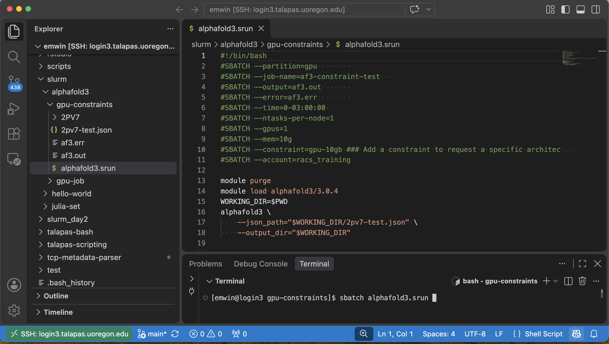

# Workflows on Talapas
This lesson introduces supporting tools for programming on Talapas like [Visual Studio Code](https://code.visualstudio.com/?_exp_home=e855cfac50), a code editor with remote development support, and [Conda](https://docs.conda.io/projects/conda/en/stable/user-guide/index.html), a popular software package and virtual environment management tool available on Talapas that can be used
to configure virtual environments for batch scripts or interactive jobs.

## Connecting to Talapas with Visual Studio Code
[Visual Studio Code](https://code.visualstudio.com) or "VS Code" is an integrated development environment (IDE) with an integrated text editor, file manager, and terminal that can connect to Talapas through an SSH connection. This allows you to develop code on Talapas from a convenient graphical user interface on your personal computer.


*VS Code when connected to Talapa, launching a Slurm batch script through the integrated terminal.*

If you would like to use VS Code on Talapas, RACS has a [guide](uoracs.github.io/talapas2-knowledge-base/docs/connecting_to_talapas/how-to_use_vscode_to_login/) for configuring the [Remote-SSH Extension](https://code.visualstudio.com/docs/remote/ssh) to work with Talapas.

### Talapas and VS Code: Best Practices

* You must connect to one of the four login nodes.
* Connect to Talapas while on the [VPN](../talapas-scripting/setup.html).
* If you are prompted for Duo Authentication when trying to connect, make sure you've added your [SSH key](../tutorials/ssh.html) to that login node.
* As always, you must launch a batch job or interactive job through Slurm to test the scripts you write with VS Code.

## What is Conda?
[Conda](https://docs.conda.io/projects/conda/en/stable/user-guide/getting-started.html) is an open-source package and environment management system. 

It allows you to manage and configure virtual environments with different sets of packages for different projects. 

Conda works across many platforms (Windows, macOS, Linux) and is popular in scientific computing and data science applications because it handles complex dependency situations like:
  - Python packages that require older versions of Python
  - non-Python libraries like R and Julia
  - packages from different channels (conda, conda-forge, pip)

RACS has a detailed guide for [building, creating, and loading conda environments](https://uoracs.github.io/talapas2-knowledge-base/docs/how-to_articles/how-to_create_personal_conda_envs) on Talapas.
We will walk through some of these steps in this exercise.

### Benefits of Using Conda
1. Conda environments allow for reproducibility and consistency when running code on different devices and operating systems.
2. Conda only loads the packages you need for that specific workflow (helps reduce the amount of "clutter" in your environment)
3. Each Conda environment is a self-contained workspace, so you can: 
    - Use different Python versions for different projects (e.g. Python 3.10 & 3.12)
    - Avoid dependency conflicts between projects

Many researchers maintain separate conda environments for different projects and contexts.
We highly recommend this approach for reproducibility, consistency, and ease of replicating environmental configurations
among colleagues.

### Conda Options on Talapas 
We have two main Conda distributions available to users: 
- [**miniconda3**](https://continuumio-docs.readthedocs-hosted.com/miniconda/) - the offical source, maintained by Anaconda, uses defaults as default channel, minimal installer for the Anaconda ecosystem
- [**miniforge3**](https://github.com/conda-forge/miniforge) - an open-source distribution, maintained by community, uses conda-forge as default channel, fully open-source Conda installer using community packages. 

We recommend using the latest version of miniconda3, `miniconda3/20260319` for most use cases.

## Building Conda Environments from Scratch
Connect to a Talapas login node using a terminal application of your choice. If you would like to connect through your web browser, use the [Talapas OnDemand shell](https://ondemand.talapas.uoregon.edu/pun/sys/shell/ssh/login2.talapas.uoregon.edu).

Copy the `/projects/racs_training/intro-hpc-f26/conda` folder to your home directory. Don't forget the `-r` flag.

```bash
cp -r /projects/racs_training/intro-hpc-f26/conda ~
```

Navigate inside the new `conda` folder and use `ls` to inspect the contents.

```bash
cd ~/conda
ls
```
```output
compute_stats.py  compute_stats.sbatch  compute_stats_test.sbatch  err  out
```

Inspect `compute_stats.py` with `cat`.

```bash
cat compute_stats.py
```
```python
import os, time
import numpy as np
from multiprocessing import Pool

N_WORKERS = int(os.environ.get("SLURM_CPUS_PER_TASK", 16))
RUN_SECONDS = 1 * 60          # runs for one minute
MATRIX_N = 4096                # 4096x4096 float64 = ~134 MB per matrix
BUFFER_GB = 1.4                # per-worker memory buffer (16 x 1.4 = ~22 GB)


def worker(seed):
    rng = np.random.default_rng(seed)
    buf = rng.random(int(BUFFER_GB * 1e9 / 8))
    a = rng.random((MATRIX_N, MATRIX_N))
    b = rng.random((MATRIX_N, MATRIX_N))

    end = time.time() + RUN_SECONDS
    iters, inside, total = 0, 0, 0
    while time.time() < end:
        c = a @ b
        a = c / np.linalg.norm(c)
        pts = rng.random((5_000_000, 2))
        inside += int(np.count_nonzero((pts ** 2).sum(axis=1) <= 1.0))
        total += 5_000_000
        buf[::1000] += 1e-9
        iters += 1
    return seed, iters, inside, total


if __name__ == "__main__":
    print(f"Starting {N_WORKERS} workers for {RUN_SECONDS/60:.0f} minutes", flush=True)
    with Pool(N_WORKERS) as pool:
        results = pool.map(worker, range(N_WORKERS))
    inside = sum(r[2] for r in results)
    total = sum(r[3] for r in results)
    print(f"Matrix iterations (all workers): {sum(r[1] for r in results)}")
    print(f"Pi estimate from {total:,} samples: {4 * inside / total:.8f}")
```

This Python script estimates pi for exactly one minute before exiting. It requires the package [numpy](https://numpy.org/), which is not available in a default Python installation. 

We need to create a virtual environment with `numpy` installed in order to execute the script.

Load the latest version of `miniconda3` with the `module load` command.

```bash
module load miniconda3/20260319
```

List the conda environments available to you with `conda env list`.

```bash
conda env list
```
```output
# conda environments:
#
# * -> active
# + -> frozen
                         /gpfs/projects/library_it/shared/xml-processing
dualkernel2              /home/emwin/.conda/envs/dualkernel2
geospatial               /home/emwin/.conda/envs/geospatial
...
```

There are a number of public Conda environments maintained by RACS in the `/packages/miniconda3/` folder. If you have not created any Conda environments of your own, then only the public environments compiled by RACS will be listed.

Now that you've loaded `miniconda3`, we can use the `conda create` command to create environments. 

Start by creating a new Python 3.12 environment with the name `hpc-workshop-f26`. This new environment will be stored inside the `.conda` folder of your home directory. 

```bash
conda create --name hpc-workshop-f26 python=3.12 -y
```
```output
# To activate this environment, use
#
#     $ conda activate hpc-workshop-f26
#
# To deactivate an active environment, use
#
#     $ conda deactivate
```

We have now created an environment with Python 3.12 installed and no specialized packages.

Activate the `hpc-workshop-f26` environment.

```bash
conda activate hpc-workshop-f26
```

Observe that your terminal prompt now has the name of your current Conda environment `hpc-workshop-f26` as a prefix.

```output
(hpc-workshop-f26) [emwin@login2 conda]$ 
```

From inside our conda environment, we can run the `which python` command to confirm we are using the Python executable stored inside `/.conda/envs/hpc-workshop-f26/bin/`.

```bash
which python
```
```output
~/.conda/envs/hpc-workshop-f26/bin/python  
```

To install Python packages to an environment, use the `conda install` comand followed by the names of the packages you want to install. Use `-y` to skip confirmation prompts.

```bash
conda install numpy -y
```

To see which packages are in the current environment, use `conda list`.

```bash
conda list
```
```output
# packages in environment at /home/emwin/.conda/envs/hpc-workshop-f26:
#
# Name                     Version          Build                  Channel
_libgcc_mutex              0.1              main
_openmp_mutex              5.1              52_gnu
blas                       1.0              mkl
bzip2                      1.0.8            h5eee18b_6
ca-certificates            2026.10.20       h06a4308_0
icu                        73.1             h6a678d5_0
intel-openmp               2025.0.0         h06a4308_1172
ld_impl_linux-64           2.44             h9e0c5a2_3
libexpat                   2.9.0            h7354ed3_0
libffi                     3.4.8            h06d3fd0_3
libgcc                     15.2.0           h69a1729_8
libgcc-ng                  15.2.0           h166f726_8
libhwloc                   2.12.1           default_hf1bbc79_1000
libstdcxx                  15.2.0           h39759b7_8
libstdcxx-ng               15.2.0           hc03a8fd_8
libuuid                    1.41.5           h5eee18b_0
libxcb                     1.17.0           h9b100fa_0
libxml2                    2.13.9           h2c43086_0
libzlib                    1.3.2            h47b2149_0
mkl                        2025.0.0         h6d8faa4_942
mkl-service                2.9.0            py312h365c7f6_0
mkl_fft                    2.4.0            py312h14d6ddd_0
mkl_random                 1.5.0            py312h973aee8_0
ncurses                    6.6              hfaaeb4e_0
numpy                      2.5.4            py312ha8834a8_0
numpy-base                 2.5.4            py312h7c74580_0
openssl                    3.5.9            h1b28b03_0
...
```

You can use piping and `grep` to confirm that `numpy` is among the installed packages.

```bash
conda list | grep "numpy"
```
```output
numpy                      2.5.4            py312ha8834a8_0
numpy-base                 2.5.4            py312h7c74580_0
```

Now that you've finished configuring your Conda environment, deactivate it with `conda deactivate`. 

To avoid unintentional software interactions, always use the `sbatch` and `salloc` commands from *outside* of a virtual environment.

```bash
conda deactivate
```

Inspect `compute_stats.sbatch` with `cat`.
```bash
cat compute_stats.sbatch
```
```bash
#SBATCH --job-name=compute_stats
#SBATCH --partition=compute
#SBATCH --account=racs_training
#SBATCH --nodes=1
#SBATCH --ntasks=1
#SBATCH --cpus-per-task=16
#SBATCH --mem=30G
#SBATCH --time=00:15:00
#SBATCH --output=out/compute_stats_%j.out 
#SBATCH --error=err/compute_stats_%j.err  

export OMP_NUM_THREADS=1   # each worker is single-threaded; parallelism comes from the pool
export OPENBLAS_NUM_THREADS=1
export MKL_NUM_THREADS=1

module purge
module load miniconda3/20260319 
conda activate hpc-workshop-f26

echo "Job $SLURM_JOB_ID on $(hostname) with $SLURM_CPUS_PER_TASK CPUs, started $(date)"
python3 compute_stats.py  
echo "Finished $(date)"
conda deactivate
```

Let's unpack this job:

* This job requests 30GB of memory and a time limit of 15 minutes.
* As a [Python multiprocessing job](https://docs.python.org/3/library/multiprocessing.html#introduction), it requests 16 CPU cores and allocates one thread per core.
* It activates the `miniconda3/20260319` environment.
* It uses `conda activate` to activate the `hpc-workshop-f26` environment we already created.
* From inside the `hpc-workshop-f26` environment, it launches `python3` and runs the `compute_stats.py` program.
* `conda deactivate` is used to exit the environment after the job finishes.

Launch the job with `sbatch`.
```bash
sbatch compute_stats.sbatch
```
```output
Submitted batch job 48182217
```

Check `sacct` for the job's completion status. 
```bash
sacct
```
```output
JobID           JobName  Partition    Account  AllocCPUS      State ExitCode 
------------ ---------- ---------- ---------- ---------- ---------- -------- 
48182217     compute_s+    compute racs_trai+         16  COMPLETED      0:0 
48182217.ba+      batch            racs_trai+         16  COMPLETED      0:0 
48182217.ex+     extern            racs_trai+         16  COMPLETED      0:0
```

Check your output logs with `cat`.
```bash
cat out/*
```
```output
Job 48182217 on n0135.talapas.uoregon.edu with 16 CPUs, started Wed Oct 28 17:01:21 PDT 2026
Finished Wed Oct 28 17:01:21 PDT 2026
```

As you can see, the job completed successfully because it was able to import the `numpy` package from the conda environment.

## Exporting a Conda Environment
To share our Conda environment, we can create a textual representation of the packages installed in the environment in a special `.yml` configuration file. 
Conventionally, Conda environments bundled with source code are named `environment.yml`.

The `conda export` command [exports the environment](https://docs.conda.io/projects/conda/en/latest/user-guide/tasks/manage-environments.html#sharing-an-environment), in an output format of your choice. 
The resulting file can be used to recreate the environment on a different computer or even on a different operating system.

In this example, we will use the default format and write the configuration to the file `environment.yml`. The `-n` argument allows us to specify which environment we want to export. 

```bash
conda export -n hpc-workshop-f26  > environment.yml
```

Inspect the contents of `environment.yml` with `cat`.
```bash
cat environment.yml
```
```output
name: hpc-workshop-f26
channels:
  - defaults
dependencies:
  - _libgcc_mutex=0.1=main
  - _openmp_mutex=5.1=52_gnu
  - blas=1.0=mkl
  - bzip2=1.0.8=h5eee18b_6
  - ca-certificates=2026.10.20=h06a4308_0
  - icu=73.1=h6a678d5_0
  - intel-openmp=2025.0.0=h06a4308_1172
  - ld_impl_linux-64=2.44=h9e0c5a2_3
  - libexpat=2.9.0=h7354ed3_0
  - libffi=3.4.8=h06d3fd0_3
  - libgcc=15.2.0=h69a1729_8
  - libgcc-ng=15.2.0=h166f726_8
  - libhwloc=2.12.1=default_hf1bbc79_1000
  - libstdcxx=15.2.0=h39759b7_8
  - libstdcxx-ng=15.2.0=hc03a8fd_8
  - libuuid=1.41.5=h5eee18b_0
  - libxcb=1.17.0=h9b100fa_0
  - libxml2=2.13.9=h2c43086_0
  - libzlib=1.3.2=h47b2149_0
  - mkl=2025.0.0=h6d8faa4_942
  - mkl-service=2.9.0=py312h365c7f6_0
  - mkl_fft=2.4.0=py312h14d6ddd_0
  - mkl_random=1.5.0=py312h973aee8_0
  - ncurses=6.6=hfaaeb4e_0
  - numpy=2.5.4=py312ha8834a8_0
  - numpy-base=2.5.4=py312h7c74580_0
  - openssl=3.5.9=h1b28b03_0
  - packaging=26.3=py312h06a4308_0
  - pip=26.2.2=pyhc872135_0
  - pthread-stubs=0.3=h47b2149_2
  - python=3.12.16=hcd0331c_0
  - readline=8.3=hc2a1206_0
  - setuptools=84.0.0=py312h06a4308_0
  - sqlite=3.53.4=h795bf6d_0
  - tbb=2022.3.0=h698db13_0
  - tbb-devel=2022.3.0=h698db13_0
  - tk=8.6.15=h54e0aa7_0
  - tzdata=2026c=he532380_0
  - wheel=0.48.0=py312h06a4308_0
  - xorg-libx11=1.8.14=h65de747_0
  - xorg-libxau=1.0.12=h9b100fa_0
  - xorg-libxdmcp=1.1.5=h9b100fa_0
  - xorg-xorgproto=2025.1=h47b2149_0
  - xz=5.8.4=h140a991_0
  - zlib=1.3.2=h47b2149_0
prefix: /home/emwin/.conda/envs/hpc-workshop-f26
```

This list is lengthy because it includes the package manually installed (numpy) *and* its dependencies.

If you use the `--from-history` flag, Conda will only export the packages you instructed it to install, leaving the conda solver to choose versions and dependencies. This approach is less precise but more resilient to cross-platform dependency conflicts.

```bash
conda export -n hpc-workshop-f26 --from-history
```
```output
name: hpc-workshop-f26
channels:
  - defaults
dependencies:
  - python=3.12
  - numpy
prefix: /home/emwin/.conda/envs/hpc-workshop-f26
```

### What About `prefix`?
While the `/prefix/` line indicates where the environment exists on *your* filesystem -- a hidden `.conda` folder in your Talapas home directory -- this line is [ignored by Conda](https://github.com/conda/conda/issues/10466) when environments are created from a file. You do not need to remove this line before passing it on to a colleague.

## Creating A Conda Environment from a .yml File
Because you cannot have two environments with the same name, we'll practice creating a Conda environment from a file with a slightly different environment with a larger selection of popular Python packages.

First, create an environment file called `pandas.yml` with `nano`. 
```bash
nano pandas.yml
```
```bash
name: pandas-f26
channels:
  - conda-forge
dependencies:
  - numpy
  - pandas=3.1.0
  - matplotlib
  - seaborn
  - jupyterlab=4.6.5
  - ipywidgets
```

* Observe that two packages have explicit version requirements in this file: `pandas` and `jupyterlab`.

### Conda Channels
This environment file defines an environment named `pandas-f26` and specifies that packages should be downloaded from the `conda-forge` channel. [Channels](https://docs.conda.io/projects/conda/en/latest/user-guide/concepts/channels.html) are repositories from which packages are downloaded.

Conda defaults to an official channel called `defaults`. The `conda-forge` channel has a larger repository of packages from the broader community.

Conda looks for packages in channels in the order that the channels appear.

If you do not specify version numbers, Conda will select the latest *compatible* version of a given package. 

We can create our new environment as defined in `pandas.yml` using `conda env create` followed by `-f` to indicate the name of the file to read in.
```bash
conda env create -f pandas.yml
```

When the environment finishes building, you will get a message like this.
```output
#
# To activate this environment, use
#
#     $ conda activate pandas-f26
#
# To deactivate an active environment, use
#
#     $ conda deactivate
```

No two Conda environments can have the same name, so this command will fail if you try to run it a second time.

### R in Conda
You can also install R and R packages to Conda environments. Because Anaconda no longer maintains [an official R channel](https://www.anaconda.com/docs/getting-started/working-with-conda/packages/using-r-language), you must use the community-maintained packages on the `conda-forge` channel to fetch the latest versions from CRAN.

Activate the newly created `pandas-f26` environment.
```bash
conda activate pandas-f26
```

Using `--channel conda-forge` to indicate you want to install packages from the `conda-forge` channel, install the `r-base` and `r-ggplot2` packages.
```bash
conda install --channel conda-forge r-base=4.5.3 r-ggplot2 -y
```
```output
Preparing transaction: done                                                                
Verifying transaction: done                                                                
Executing transaction: done  
```

All Conda versions of R packages are prefixed `r-` to distinguish them from Python packages with similar names.

Because R has been installed inside the current Conda environment, the `R` and `Rscript` commands are available on your path when `pandas-f26` is activated.

```bash
which R
```
```output
~/.conda/envs/pandas-f26/bin/R
```

```bash
which Rscript
```
```output
~/.conda/envs/pandas-f26/bin/Rscript
```

Deactivate the environment once you've finished adjusting it.

```bash
conda deactivate
```

## Using Conda Environments in Batch Scripts
To use a Conda environment you created in a Slurm batch script, you can add the following lines to your script.

Don't forget to load `miniconda3` or `miniforge3` first. Make sure to load the precisely the version of `miniconda3` or `miniforge3` you used to create the environment.

### Using Conda with Python Batch Scripts
```bash
module purge
module load miniconda3/20260319 # Assuming I used this version
conda activate [env-name]
python [python-script].py
conda deactivate
```

### Using Conda with R Batch Scripts
```bash
module purge
module load miniconda3/20260319 # Assuming I used this version
conda activate [env-name]
Rscript [r-script].R
conda deactivate
```

## Debugging Conda
Observing strange behavior with Conda on Talapas? Make sure you're not loading into a conda environment through your .bashrc file.

A default `.bashrc` looks something like this:
```bash
# .bashrc

# Source global definitions
if [ -f /etc/bashrc ]; then
	. /etc/bashrc
fi

# User specific environment
if ! [[ "$PATH" =~ "$HOME/.local/bin:$HOME/bin:" ]]
then
    PATH="$HOME/.local/bin:$HOME/bin:$PATH"
fi
export PATH

# Uncomment the following line if you don't like systemctl's auto-paging feature:
# export SYSTEMD_PAGER=

# User specific aliases and functions
```

Do not run the `conda init` command on Talapas to avoid modifying your .bashrc file unintentionally.
Instead, use `module load` to load either `miniconda3` or `miniforge3`.

### What About `pip`?
Pip is an [alternative package manager](https://www.anaconda.com/blog/understanding-conda-and-pip) and it can be paired with `venv` to create Python virtual environments. Using `pip` within a `conda` environment can introduce problems, so use this approach only when necessary.


### Useful Conda Commands

| Command | Description |
| ---------- | ---------------------------------|
| `which python`| see which python you are currently using, helpful for sanity checks | 
| `conda env list`| list out all available conda environments from loaded conda module | 
| `conda activate <environment name>` | activates specified conda environment |
| `pip list` | see packages and their versions that were installed via pip package manager |
| `conda list` | see packages and their versions installed, includes both pip and conda packages | 
| `conda search <package name>` | searches for packages within your environment | 
| `conda list --name ENVNAME --show-channel-url` | useful when trying to figure out what channel was used to install what package | 
| `conda create` | used to create conda environments either from the command line or from a file |
| `conda export -n [environment name] > [filename]` | exports a conda environment to a file |
| `conda env remove --name [environment name] --all` | deletes a conda environment (make sure you have created a backup) |


